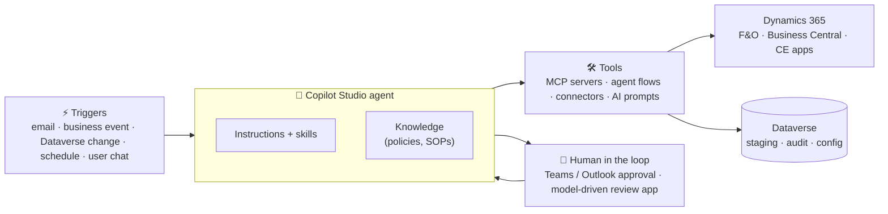

# D365 Agents — Reference Architecture, Playbook and Sample Agent

A practical kit for designing and building **AI agents for Dynamics 365** (Finance & Supply Chain, Business Central, Sales / Customer Service / Field Service) on **Copilot Studio, Dataverse and the Power Platform**.

It is based on the patterns used in Microsoft's
[FastTrack AI ERP Agent templates](https://github.com/microsoft/Dynamics-365-FastTrack-Implementation-Assets/tree/master/Agents/AI%20ERP%20Agents)
(Sales Order Agent, Period Close Agent, ERP Compliance Advisor, Inventory Fulfillment and others). It turns those patterns into a repeatable approach you can use for **any** new agent.

> **In one sentence:** every D365 agent is a **brain** (Copilot Studio agent + instructions) that is **woken up** by a trigger, **looks things up and acts** through tools (MCP servers, connectors, agent flows), **remembers** its work in Dataverse, and **asks a human** before doing anything risky.

---

## What's in this repo

| Folder / file | What it gives you | Who it's for |
| --- | --- | --- |
| [`docs/01-reference-architecture.md`](docs/01-reference-architecture.md) | The layered architecture diagram that every agent fits into, and how each D365 app plugs in | Architects, customer presentations |
| [`docs/02-solution-approach.md`](docs/02-solution-approach.md) | The step-by-step playbook from idea to production: discovery, design, build, test, deploy, run | Project leads, consultants |
| [`docs/03-integration-patterns.md`](docs/03-integration-patterns.md) | Which way to connect to F&O, Business Central, CE apps / Dataverse, and when to use each (decision trees) | Solution architects, developers |
| [`docs/04-fasttrack-agents-anatomy.md`](docs/04-fasttrack-agents-anatomy.md) | Breakdown of the Microsoft FastTrack agents: which building blocks each uses, and what we can reuse | Everyone; good starting point |
| [`docs/05-governance-security-alm.md`](docs/05-governance-security-alm.md) | Security, responsible AI, licensing and credits, ALM and environments, monitoring | Architects, IT / CoE |
| [`samples/credit-hold-review-agent/`](samples/credit-hold-review-agent/README.md) | **A complete sample agent**: reviews sales orders on credit hold in D365 Finance, combines ERP + CRM (Dataverse) context, recommends release or keep, gets approval, and logs everything | Builders: follow it in Copilot Studio |
| [`templates/agent-design-canvas.md`](templates/agent-design-canvas.md) | A one-page canvas to fill in for every new agent idea | Workshops with customers |
| [`templates/new-agent-starter/`](templates/new-agent-starter/README.md) | Empty folder structure with placeholders, so every new agent is documented the same way | Builders |

## Quick start

1. **Learn the pattern (15 min).** Read [the reference architecture](docs/01-reference-architecture.md) and [the FastTrack anatomy](docs/04-fasttrack-agents-anatomy.md).
2. **See it applied (30 min).** Walk through the [Credit Hold Review Agent sample](samples/credit-hold-review-agent/README.md).
3. **Shape your own idea (1 workshop).** Fill in the [agent design canvas](templates/agent-design-canvas.md) with the business owner.
4. **Build it.** Copy [`templates/new-agent-starter/`](templates/new-agent-starter/README.md), then follow the [solution approach](docs/02-solution-approach.md) phase by phase.

## The big picture

## Important

Everything here is **sample guidance** to learn from and adapt. It is not a supported Microsoft product. Microsoft features named here (for example the Dynamics 365 ERP MCP server, Business Central MCP server, Dataverse MCP server and the Copilot Studio harnesses) change fast; check the links to Microsoft Learn in each document and validate in a non-production environment first.
