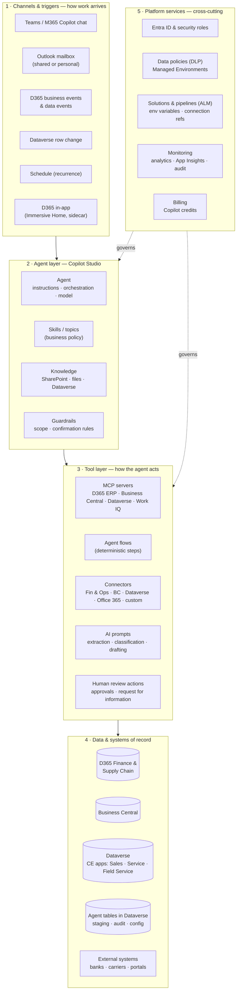
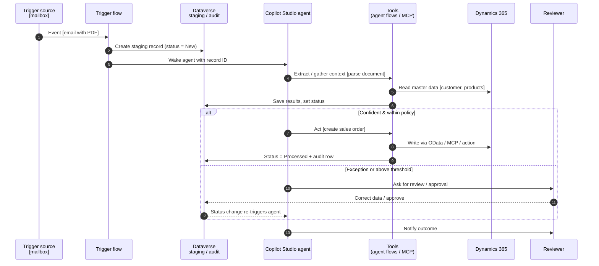
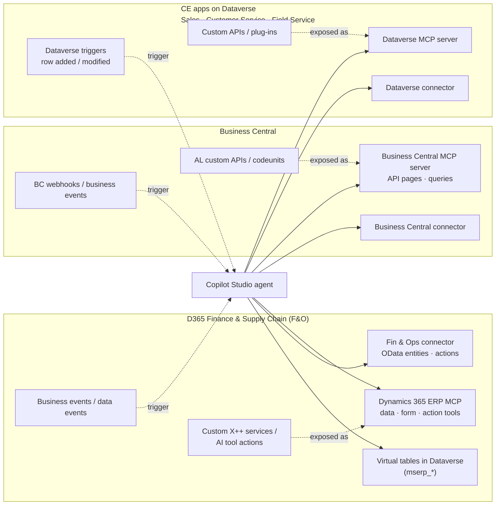

# 01 — Reference Architecture for Dynamics 365 Agents

This is the architecture that **every** agent in this repo, and every agent in the Microsoft FastTrack AI ERP templates, fits into. Learn it once and you can explain any agent to a customer with the same picture.

## 1. The simple explanation (for business audiences)

Think of an agent as a **new team member**:

| Team member analogy | Agent building block | Where it lives |
| --- | --- | --- |
| Their **job description** | Agent instructions and skills | Copilot Studio |
| What makes them **start working** (an email arrives, a manager asks, a status changes) | Triggers | Copilot Studio / Power Automate / D365 business events |
| The **systems they log into** | Tools: MCP servers, connectors, agent flows | Power Platform connectors, D365 MCP servers |
| The **rule books** they read | Knowledge | SharePoint, Dataverse, files |
| Their **notebook / work log** | Staging, audit and configuration tables | Dataverse |
| Their **manager's sign-off** | Human in the loop: approvals, review apps | Teams, Outlook, model-driven app |
| Their **permissions** | Identity and security roles | Entra ID, D365 security roles, Dataverse roles |
| Their **performance review** | Analytics, telemetry, evaluation tests | Copilot Studio analytics, Application Insights |

## 2. Layered reference architecture

### What each layer is responsible for

| Layer | Responsibility | Design rule of thumb |
| --- | --- | --- |
| **1. Channels & triggers** | Start the agent: a person asks, or an event happens. | Autonomous agents need an **event** trigger. Conversational agents need a **channel**. Many good agents have both. |
| **2. Agent** | Decide *what* to do next, in natural language. | Put **business policy** in skills / instructions that a business owner can read. Keep **mechanics** (how to write to ERP) in tools. |
| **3. Tools** | Do the work: read, write, calculate, ask a human. | Use **agent flows** where the steps must always run the same way (posting, status changes). Use **MCP** where the agent should discover and choose. |
| **4. Data** | Systems of record plus the agent's own tables. | The ERP stays the system of record. Dataverse holds the agent's **staging, audit and configuration**, never a second copy of the ledger. |
| **5. Platform** | Security, ALM, monitoring, cost. | Every agent ships as a **solution** with environment variables and connection references, so it can move dev → test → prod. |

## 3. Runtime sequence — the "golden path"

All the FastTrack agents follow this same shape. The Sales Order Agent is shown in brackets as an example.

**Why a staging table + status column?** It makes the agent **restartable** (a status change re-triggers the next step), **observable** (a model-driven app shows every item), and **auditable** (every decision is a row). This is the single most reusable idea in the FastTrack samples.

## 4. How each Dynamics 365 application plugs in

| Application | Read data | Write / run business logic | Trigger the agent | Notes |
| --- | --- | --- | --- | --- |
| **Finance & Supply Chain** | ERP MCP data tools; Fin & Ops connector (OData); virtual tables | ERP MCP data / form / action tools; connector *Create / Execute action*; custom X++ service | Business events (Fin & Ops connector or Dataverse *When an action is performed*); data events on virtual tables; schedule | Requires Power Platform integration for virtual tables, business events in Dataverse and the MCP server. Security = the user's / connection's F&O roles. |
| **Business Central** | BC MCP server (read-only by default); BC connector | BC MCP with configured create/modify/action permissions; AL custom APIs | BC connector triggers / webhooks; schedule | MCP configuration controls which API pages and actions are exposed. |
| **Sales / Customer Service / Field Service** | Dataverse MCP; Dataverse connector; Dataverse knowledge | Dataverse MCP `create_record` / `update_record`; Dataverse connector; Custom APIs | Dataverse *row added / modified / deleted*; *When an action is performed* | Native — the data already lives in Dataverse. Many first-party agents exist here; check before building. |
| **Any Power Platform solution** | Dataverse tables, SharePoint, any connector | Agent flows, connectors, custom connectors | Any Power Automate trigger | Same pattern; D365 is just one system behind the tools. |

See [03 — Integration patterns](03-integration-patterns.md) for the decision tree on choosing between these.

## 5. Reusable component catalogue

These are the "Lego bricks". Each FastTrack agent and the sample in this repo is a combination of them.

| # | Component | Pattern it solves | Used by (FastTrack) |
| --- | --- | --- | --- |
| C1 | **Mailbox trigger flow** → staging record | Unstructured requests arrive by email | Sales Order, User Onboarding |
| C2 | **Event trigger** (business event / Dataverse row change) | React to something that happened in D365 | Period Close, Sales Order (status change) |
| C3 | **AI prompt for document extraction** → JSON | Turn a PDF / email into structured data | Sales Order |
| C4 | **Staging tables with status lifecycle** | Restartable, observable processing | Sales Order |
| C5 | **Validation agent flows** (match to master data) | Make sure data is real before writing | Sales Order |
| C6 | **Write agent flow** (create / update in ERP) | Deterministic, audited writes | Sales Order, Period Close |
| C7 | **Read-only OData tool set** | Q&A and analysis over ERP data | ERP Compliance Advisor |
| C8 | **ERP MCP server** | Broad, discoverable read/write with user security | Inventory Fulfillment v2, Period Close |
| C9 | **Telemetry query tool** (KQL on App Insights) | Operations / diagnostics agents | Batch Telemetry, Store Monitoring |
| C10 | **Human approval** (Teams adaptive card / Outlook / RFI) | Stop before risky actions | User Onboarding, Period Close |
| C11 | **Business skills as Dataverse records** | Business owner changes policy without republishing | Period Close |
| C12 | **Audit table + model-driven review app** | Compliance evidence of every agent action | Period Close, Sales Order |
| C13 | **Notification flow** (email / Teams) | Tell people what happened | Sales Order, Period Close |
| C14 | **Evaluation test sets** | Prove the agent behaves before release | Period Close |
