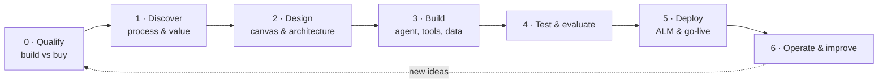
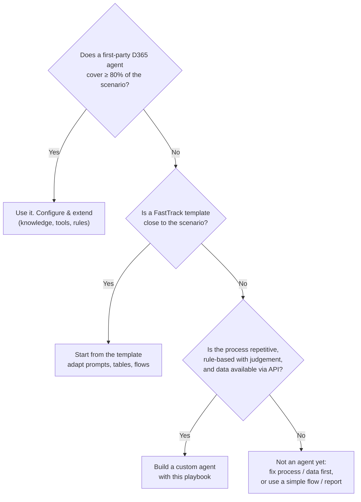

# 02 — Solution Approach: How to Build Any New D365 Agent

A repeatable playbook from "we have an idea" to "the agent runs in production". It works for Finance & Supply Chain, Business Central, CE apps and plain Dataverse / Power Platform scenarios.



| Phase | Output (definition of done) | Typical effort for a first agent |
| --- | --- | --- |
| 0. Qualify | Decision: first-party agent, extend first-party, or build custom | 1–2 days |
| 1. Discover | Process map, volumes, decision rules, success KPIs | 1 week |
| 2. Design | Completed [agent design canvas](../templates/agent-design-canvas.md) and architecture diagram | 1 week |
| 3. Build | Solution with agent, tools, tables, env variables | 2–4 weeks |
| 4. Test | Evaluation set passed, security review signed | 1–2 weeks |
| 5. Deploy | Managed solution in production, runbook, owners trained | 1 week |
| 6. Operate | Monthly review of KPIs, credits, failures | Ongoing |

---

## Phase 0 — Qualify: build, extend or buy?

Microsoft ships first-party agents across D365 (for example in Finance, Supply Chain, Sales, Customer Service and Business Central). **Always check before building.**



**Good agent candidates** have: high volume, a human today who reads several screens and makes a judgement, clear policy, and a measurable outcome (hours saved, cycle time, errors).
**Poor candidates**: pure data moves (use a flow or integration), rare one-off decisions, or processes with no written policy.

## Phase 1 — Discover

Run a 2-hour workshop with the process owner and a user who does the work today. Capture:

1. **Trigger** — what starts the work? (email, status, date, request)
2. **Steps today** — which screens / reports do they open? Which fields do they look at?
3. **Decision** — what rule or judgement do they apply? Where is it written down?
4. **Action** — what do they change in D365? Who must approve?
5. **Exceptions** — top 5 reasons it goes wrong.
6. **Volumes & value** — items per day, minutes per item, cost of delay / error.
7. **Data access** — which entities / tables / APIs hold that data? Are they exposed (OData entity, API page, Dataverse table)?

> 💡 *Tip for customer workshops:* ask the user to share their screen and do 3 real cases. Every field they look at becomes a **tool input/output**; every rule they say out loud becomes an **instruction or skill**.

## Phase 2 — Design

### 2.1 Pick the agent type

| Type | Who starts it | Example | Key design focus |
| --- | --- | --- | --- |
| **Conversational assistant** | A user in Teams / M365 Copilot / D365 | Compliance Advisor, Inventory Fulfillment | Good tool descriptions, knowledge, read-only by default, confirm writes |
| **Autonomous (event-driven)** | An event or schedule | Sales Order, Period Close | Staging + status lifecycle, idempotency, human approval thresholds, notifications |
| **Hybrid** | Both | Credit Hold Review (sample) | Same tools serve both entry points |
| **Process orchestrator** | Checklist / task status + chat | Period Close, Inventory Close (sample) | Local behaviors vs business skills, authorization gate per task, verified status, claims, batch hand-over, evaluation sets |

### 2.2 Decide the autonomy level per action

Use this ladder for **each action** the agent can take, not for the agent as a whole:

| Level | Agent does | Human does | Use when |
| --- | --- | --- | --- |
| **L0 Inform** | Reads, summarises | Decides and acts | Q&A, analysis, first release of any agent |
| **L1 Recommend** | Proposes a decision with reasons | Approves / rejects, then acts | Financial impact, policy judgement |
| **L2 Act with approval** | Acts *after* human approval | Approves | Writes to ERP with moderate risk |
| **L3 Act, then notify** | Acts within thresholds, notifies | Reviews exceptions | High volume, low risk, proven accuracy |
| **L4 Fully autonomous** | Acts silently, audited | Periodic audit | Only after L3 has a track record |

Start one level lower than the business wants, then promote based on evaluation results.

### 2.3 Choose integration per system

Use the decision tree in [03 — Integration patterns](03-integration-patterns.md). Short version:

- **Reads + exploratory actions** → MCP server for that app (ERP MCP, Business Central MCP, Dataverse MCP).
- **Exact, audited writes** → agent flow calling the connector / OData action / custom API.
- **Event triggers** → business events (F&O), Dataverse row triggers (CE), BC connector triggers.
- **Unstructured input** → AI prompt with JSON output, saved to a Dataverse staging table.

### 2.4 Design the agent's own data in Dataverse

Most autonomous agents need three kinds of tables (use your publisher prefix):

| Table | Purpose | Key columns |
| --- | --- | --- |
| **Work item / staging** | One row per thing the agent works on | Status (choice), source reference, extracted data (JSON), validation message, assigned reviewer |
| **Audit / decision log** | One row per agent decision or action | Work item, action, inputs summary, recommendation, confidence, approver, outcome, timestamp, D365 reference |
| **Configuration / skills** | Thresholds and business rules owners can change | Name, value, description, active |

### 2.5 Write the design down

Fill the [agent design canvas](../templates/agent-design-canvas.md), draw the sequence diagram (copy the one in the [reference architecture](01-reference-architecture.md#3-runtime-sequence--the-golden-path)), and get sign-off from the process owner **and** security.

## Phase 3 — Build

Build order that avoids rework:

1. **Solution & publisher** — create an unmanaged solution in a dev environment. Everything below goes inside it.
2. **Environment variables** — company, thresholds, mailboxes, reviewer, D365 instance URL.
3. **Connection references** — one per connector (Fin & Ops, Dataverse, Office 365, Teams…).
4. **Dataverse tables, choices, security role, model-driven app.**
5. **Tools, deterministic ones first** — agent flows with one clear input (usually the work-item GUID) and a typed output (`Respond to the agent`). Test each flow alone.
6. **MCP servers** — add ERP / BC / Dataverse MCP; switch off tools the agent must not use (turn off *Allow all*).
7. **AI prompts** — extraction or recommendation prompts with JSON output and examples.
8. **Agent** — instructions, skills, knowledge, tool descriptions, triggers.
9. **Human-in-the-loop** — approvals (Teams / Outlook / request for information), review app.
10. **Notifications & audit.**

### Writing good agent instructions

Follow the Sales Order Agent style: short, verb-driven, one verb → one tool, explicit order and stop conditions.

```text
ROLE: You are the <Name> agent for <business area> in <company>.
SCOPE: Only handle <X>. Politely decline anything else.

WHEN TOLD TO <VERB 1> a <work item>:
  1. Call <Tool A> with the work item ID.
  2. Call <Tool B> ...
  3. Do not skip or reorder steps. Wait for each step to succeed.

DECISION POLICY: Follow the <Policy> skill. If the skill and these rules conflict, these rules win.

NEVER:
  - Write to Dynamics 365 without an approved decision from <Tool: Request approval>.
  - Invent IDs, amounts or customer data. If data is missing, set status = Manual Review.

ALWAYS:
  - Log every decision with <Tool: Log decision>.
  - Re-read the record after a write to confirm the change.
```

### Writing good tool descriptions

The orchestrator chooses tools by their **name + description + input descriptions**. Make them unambiguous:

| ❌ Weak | ✅ Strong |
| --- | --- |
| "Gets customer" | "Returns the credit profile for ONE customer account in ONE legal entity: credit limit, balance, overdue amount, oldest overdue days. Input: customer account (e.g. US-001) and company (e.g. USMF)." |
| input `text` — "Please enter your input" | input `holdId` — "GUID of the Credit Hold Review record in Dataverse. Example: 7b62d6b9-f2a4-f011-bbd3-7c1e5217cd7c. Do not include the prefix 'ID:'" |

## Phase 4 — Test & evaluate

| Test type | What it proves | How |
| --- | --- | --- |
| **Tool unit tests** | Each flow works alone | Run each agent flow with known inputs |
| **Golden-path scenarios** | Agent picks the right tools in the right order | Copilot Studio test pane + activity map |
| **Evaluation set** | Decisions are correct across many cases | 20–50 real (anonymised) cases with expected outcome; measure accuracy before each release |
| **Negative / safety tests** | Agent refuses out-of-scope and unsafe requests | Prompt-injection in emails/documents, requests to bypass approval, missing data |
| **Security tests** | Least privilege works | Run as a user *without* the role; confirm denial |
| **Volume & cost** | Credits per item are known | Measure credits per work item over a test batch |

Release gate example: ≥ 95 % correct on the evaluation set, 0 unsafe actions, credits per item within budget.

## Phase 5 — Deploy

1. Export as **managed** solution (or use Power Platform pipelines) → test → production.
2. Provide a **deployment-settings JSON** for environment variables and connection references.
3. Post-import checklist: map connections, turn on flows, enable virtual tables / MCP / business events, publish the agent, share with users, assign security roles.
4. Start in **shadow mode** (L1 recommend only) for 2–4 weeks; compare to human decisions.
5. Hand over a **runbook**: how to pause the agent, how to reprocess, who to call.

## Phase 6 — Operate & improve

Monthly review with the business owner:

- Volume processed, % fully automated, % manual review, top exception reasons
- Decision accuracy (sample of audit rows vs. human judgement)
- Credits consumed vs. budget
- Failed flow runs and their causes
- Candidate promotions on the autonomy ladder (L1 → L2 → L3)

---

## Checklist: is my agent production-ready?

- [ ] Process owner and security have signed the design canvas
- [ ] All customer-specific values are environment variables
- [ ] All connections are connection references; service accounts are least-privilege
- [ ] Every write to D365 is either approved by a human or within a documented threshold
- [ ] Every decision is logged in an audit table
- [ ] Writes are verified by re-reading D365
- [ ] Reprocessing a work item twice cannot create duplicates (idempotent)
- [ ] Evaluation set passed and stored with the solution
- [ ] Data policy (DLP) allows exactly the connectors used
- [ ] Credits per item measured and billing configured
- [ ] Runbook and owners documented
