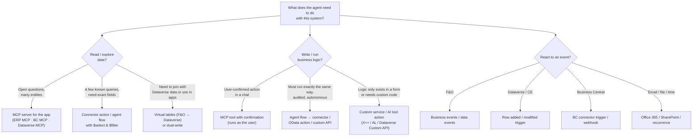
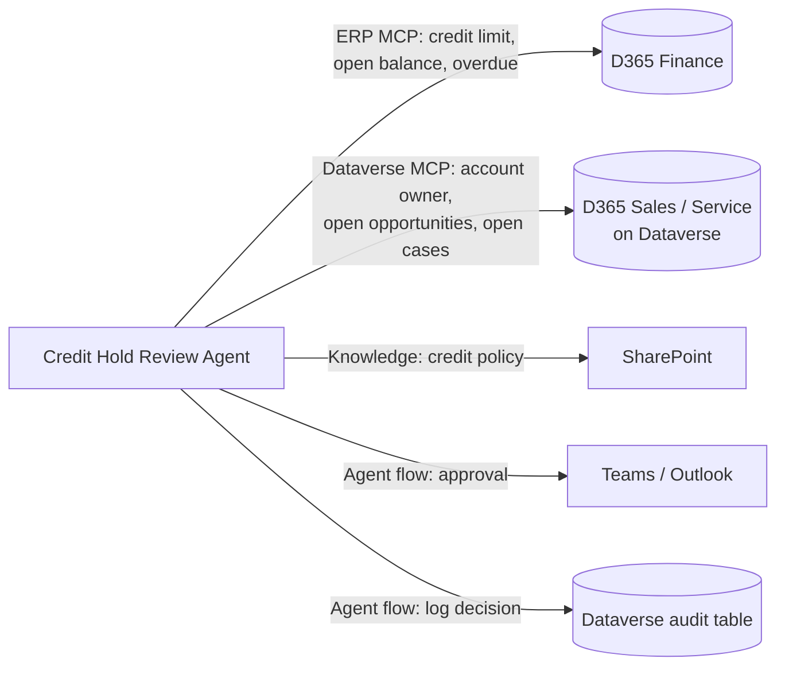

# 03 — Integration Patterns per Dynamics 365 Application

How an agent **reads**, **writes** and **gets triggered** for each D365 application, and how to choose.

## 1. Decision tree — choosing the tool type

## 2. Dynamics 365 Finance & Supply Chain (F&O)

| Option | What it is | Best for | Watch-outs |
| --- | --- | --- | --- |
| **Dynamics 365 ERP MCP server** | Dynamic MCP server: **data tools** (CRUD on data entities), **form tools** (navigate pages, set fields, click actions), **action tools** (business logic exposed by developers). Runs with the signed-in user's roles and record-level security. | Conversational agents; broad read; actions that only exist on forms | Enable the MCP feature and allowed MCP clients. Billing differs by client (see [Microsoft Learn](https://learn.microsoft.com/dynamics365/fin-ops-core/dev-itpro/copilot/copilot-mcp#licensing)). Use the *dynamic* server; the older 13-tool static server is retired. |
| **Fin & Ops Apps (Dynamics 365) connector** | Power Platform connector: *List items*, *Get record*, *Create*, *Update*, *Execute action* on OData entities | Deterministic agent flows; read-only tool sets (Compliance Advisor) | One action per entity; set `$select`/`$filter` to limit data; instance URL is chosen per action (hard to move between environments unless parameterised). |
| **Virtual tables (`mserp_*`)** | F&O entities surfaced as Dataverse tables | Joining ERP and CE data; Dataverse triggers on ERP data; model-driven apps | Must be made visible per entity (*Available Finance and Operations Entities*). Performance depends on the entity. |
| **Dual-write** | Near-real-time sync of master data F&O ↔ Dataverse | Customer / product master shared with CE | Not for agent-only needs; it's an integration architecture decision. |
| **Business events** | F&O publishes events (workflow, application, **alerts as business events**) | Autonomous triggers | Payloads are small (IDs) — read the details afterwards. Custom events need X++. |
| **Custom X++ service / AI tool action** | Developer exposes business logic as an OData action or MCP action tool | Writes that need validation the standard entity doesn't do | Requires F&O development and deployment (`.axpp`), as the Compliance Advisor and Payment Recon agents do. |

**Rule of thumb:** MCP for reading and for user-confirmed actions; agent flows over the connector (or a custom action) for autonomous writes.

## 3. Business Central

| Option | Best for | Notes |
| --- | --- | --- |
| **Business Central MCP server** | Agents that discover API pages / queries | Read-only on eligible APIs by default. Create/modify/delete/actions need an **MCP server configuration** with *Unblock Edit Tools* and per-object permissions. *Dynamic tool mode* (`bc_actions_search/describe/invoke`) helps with Copilot Studio's tool limit. |
| **Business Central connector** | Agent flows; explicit actions with custom descriptions | Can be combined with MCP in the same agent. |
| **AL custom API pages / codeunits** | Business logic not in standard APIs | Exposed through the MCP server as action tools (`_COD<ID>`). |
| **Triggers** | BC connector triggers (record created/changed), webhooks, schedule | Same staging-table pattern applies. |

## 4. CE apps (Sales, Customer Service, Field Service) and any Dataverse solution

| Option | Best for | Notes |
| --- | --- | --- |
| **Dataverse MCP server** | Search, query (`read_query`), fetch, create/update records with Dataverse RBAC | Must be enabled and the Copilot Studio client allowed for the environment. Turn off schema tools (`create_table`, `delete_table`…) for business agents. |
| **Dataverse connector** | Deterministic flows; triggers | *When a row is added, modified or deleted*; *When an action is performed* (also used for F&O business events). |
| **Dataverse as knowledge** | Grounding answers in table data | Good for Q&A; not for writes. |
| **Custom APIs / plug-ins** | Server-side logic with transactions | Expose as tools via the connector or MCP. |

Before building on CE, check the first-party agents in Sales, Customer Service and Field Service — many common scenarios (case management, lead research, scheduling) already exist.

## 5. Cross-application agents

Many valuable agents combine systems. Example from the [sample](../samples/credit-hold-review-agent/README.md):

**Identity tip:** if F&O and CE share customers through dual-write or a common key (customer account number), the agent can join them reliably. Otherwise give the agent a lookup tool that maps one ID to the other — never let the model "guess" the match.

## 6. Identity — who does the agent act as?

| Mode | When | Consequence |
| --- | --- | --- |
| **End-user credentials** (MCP, user-authenticated connector) | Conversational agents | Agent can never do more than the user. Best default. |
| **Maker-provided / service account connection** | Autonomous agents with no user present | The account's D365 roles = the agent's power. Create a **dedicated least-privilege role** (like `AuditAgentReader`), never System Administrator. |
| **Service principal / app registration** | Server-to-server (Graph, F&O OData) | Register in Entra ID and in F&O *Microsoft Entra applications*; store secrets in Key Vault / env variables of type secret. |
