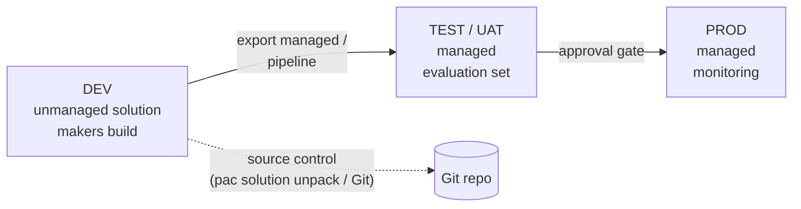

# 05 — Governance, Security, ALM and Cost

## 1. Security design

| Topic | Practice |
| --- | --- |
| **Least privilege** | Create a dedicated D365 security role per agent (e.g. *Credit Hold Agent Reader*). Read-only where possible. Separate *reviewer* roles in Dataverse. |
| **Act as the user where possible** | MCP servers and user-authenticated connectors inherit the user's D365 roles and record-level security. |
| **Service accounts** | For autonomous agents: dedicated, licensed, non-interactive account; MFA/conditional access per policy; documented owner. |
| **Data policies (DLP)** | Put the agent in a **Managed Environment** with a data policy that allows only the connectors and MCP servers it needs. MCP access is governed by the same connector policies. |
| **Secrets** | Never in instructions, prompts or flows. Use environment variables of type *secret* backed by Azure Key Vault. |
| **Prompt injection** | Treat email bodies, attachments and comments as **data**, not instructions. State this in the agent instructions and test it. |
| **Turn off unused tools** | On an MCP server, disable *Allow all* and enable only the tools needed (e.g. no `delete_record`, no `create_table`). |

## 2. Responsible AI

- **Transparency:** users and approvers see *why* the agent recommends something (reasons + data used).
- **Human accountability:** a named human owns every financial posting or access grant.
- **Auditability:** every decision and action is written to an audit table with inputs and outcome.
- **Fallback:** if a tool fails or data is missing, the agent stops and routes to manual review — it does not improvise.
- **Document it:** add a short Responsible AI FAQ per agent (see the ERP Compliance Advisor's `Responsible-AI-FAQ.md` in the FastTrack repo for an example).

## 3. Environments & ALM

| Practice | Why |
| --- | --- |
| One **solution** per agent (or per agent family) with your publisher prefix | Clean deployment and ownership |
| **Environment variables** for every customer-specific value | Same package in every environment |
| **Connection references** for every connector | Map connections at import |
| Ship a **deployment-settings.json** | Repeatable, scripted imports (`pac solution import --settings-file`) |
| Power Platform **pipelines** or Azure DevOps / GitHub Actions with the Power Platform Build Tools | Automated, approved promotions |
| Unpack solutions into **Git** (`pac solution unpack`) | Review changes to instructions and flows like code |
| Each D365 environment is linked 1:1 to a Power Platform environment | Virtual tables, business events in Dataverse and the ERP MCP server depend on this link |

## 4. Licensing & cost (verify current rates)

| Cost driver | What to know |
| --- | --- |
| **Copilot Studio** | Agents consume **Copilot Credits** (capacity packs or pay-as-you-go). Autonomous triggers, generative answers, agent actions and agent flow actions all consume credits. |
| **AI prompts / document processing** | Extraction of large documents is the most expensive step (Sales Order Agent quotes ~30–80 credits per attachment). |
| **MCP servers** | In Copilot Studio the ERP MCP tool call is billed as an *agent action*; from other clients F&O MCP tool calls have a separate per-call rate. Check [Learn](https://learn.microsoft.com/dynamics365/fin-ops-core/dev-itpro/copilot/copilot-mcp#licensing). |
| **D365 licences** | The user or service account needs an appropriate D365 licence for the data it reads/writes. |
| **Power Automate** | Cloud flows outside the agent may need Power Automate licensing; agent flows bill against Copilot Studio capacity. |

**Estimate before you build:** credits per work item × items per month. Measure the real number in Phase 4 and set an alert on capacity.

## 5. Monitoring

| What | Where |
| --- | --- |
| Conversations, sessions, outcomes, tool use | Copilot Studio **Analytics** |
| Detailed telemetry | Connect the agent to **Application Insights** |
| Flow failures | Power Automate run history; alert on failures |
| Business outcomes | The agent's own **audit table** + a model-driven app or Power BI report |
| Credits | Power Platform admin center — capacity & consumption |

## 6. Selling agents as a subscription (protecting your IP)

If you build agents for customers and charge a monthly fee per agent, keep the valuable part, the business skills and decision prompts, out of the customer's solution:

| Lives in the customer's tenant | Lives in your tenant |
| --- | --- |
| Agent, safety instructions, local behaviors, flows, tables, review app, MCP connections. **All processing of customer data** | Business skills and prompt instructions, licence table, licence check |

The agent fetches each skill at run time from the [licensing service](../licensing-service/README.md), sending only a licence key, tenant ID, agent ID and skill name. When the licence lapses (after a warning period and a grace period), new tasks stop safely and work already in progress finishes. Customer-specific values stay in the customer's environment variables and are filled into the skills there. If your service is briefly unreachable, the customer's flow uses its last copy for a window you set (4 hours by default, never past the grace period). Because no business data or personal data reaches your tenant, PDPA obligations on your side are kept to a minimum; confirm with counsel. Customers pay Microsoft directly for their D365 licences and Copilot credits; your fee covers the agent, updates and support.
