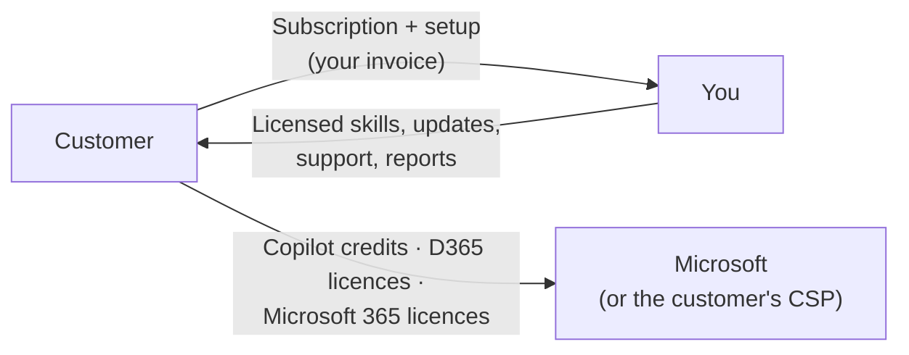

# 06 — Commercial Model: Selling D365 Agents as a Subscription

How to charge customers a monthly fee per agent (around SGD 800), what that fee covers, what the customer pays Microsoft separately, how the licence is enforced, and how to check that each deal makes sense for both sides.

Use the **[pricing calculator](../tools/pricing-calculator/index.html)** (open the file in a browser) to price a specific customer. All figures here come from that calculator's sample settings.

> **Your costs in this doc are placeholders, not your real figures:** 3 hours a month per agent (1.5 support, 0.5 monitoring, 1 skill maintenance) at SGD 90 an hour, SGD 15 a month per agent as its share of hosting the licensing service in Azure (explained in section 4), and a setup day rate of SGD 1,500. Replace them with your own in the calculator before relying on any margin figure.
>
> Figures are planning estimates in SGD, excluding GST (9%). Microsoft rates were checked against [Copilot Studio billing rates](https://learn.microsoft.com/microsoft-copilot-studio/requirements-messages-management) in October 2026. Confirm current rates and your own costs before quoting. This isn't legal or tax advice.

---

## 1. The model on one page

| Element | Recommendation |
| --- | --- |
| **What you sell** | A subscription to one agent: the licensed skills, updates, monitoring, tuning and support |
| **Price** | Three tiers per agent: Standard SGD 800, Plus SGD 1,400, Enterprise SGD 2,400 per month |
| **One-off setup** | 6 days × day rate (about SGD 9,000) for configuration, test, shadow run and go-live |
| **Term** | 12 months minimum; 10% discount for annual prepayment |
| **Usage allowance** | Included work items per month; overage per extra item; extra legal entities as an add-on |
| **Microsoft costs** | Paid by the customer to Microsoft (Copilot credits, D365 and Microsoft 365 licences). Not resold by you |
| **Enforcement** | The [licensing service](../licensing-service/README.md) serves the skills only while the licence is valid |
| **Your target margin** | At least 50% on the subscription after your support and running costs |

## 2. Two bills, never mixed

| | Your invoice | Microsoft's bill |
| --- | --- | --- |
| **Covers** | The agent and its skills, updates, monitoring, monthly report, support, licensing service | Copilot Studio credits, D365 user licences, Microsoft 365 / Copilot licences, Dataverse storage |
| **Who controls the amount** | Your contract (tier, allowance, overage) | Usage, and the monthly limit the customer's admin sets per agent |
| **Your risk** | Your support hours | None, if the customer pays Microsoft directly |

**Why keep them apart:** you can't resell Microsoft's services unless you're a Microsoft CSP partner, and if you bundle credits into your price, heavy usage eats your margin. If you are a CSP and want one invoice, show credits as a separate pass-through line with a monthly cap.

## 3. What the subscription includes

| | Standard | Plus | Enterprise |
| --- | --- | --- | --- |
| **SGD per month** | 800 | 1,400 | 2,400 |
| **Work items included per month** | 500 | 2,000 | 10,000 |
| **Overage per extra item** | SGD 1.00 | SGD 0.60 | SGD 0.30 |
| **Legal entities included** | 1 (extra SGD 250 each) | 3 (extra SGD 250 each) | Unlimited |
| **Policy / skill changes on request** | 2 per quarter | Monthly | As needed |
| **Monthly KPI report** | ✅ | ✅ | ✅ + quarterly review |
| **Re-test after Microsoft or D365 updates** | ✅ | ✅ | ✅ |
| **Support response** | Business hours, 2 business days | 1 business day | 4 business hours |
| **Offline window if the licensing service is down** | 4 hours | 4 hours | Up to 24 hours |

**A work item** is the unit the agent does work on: one credit hold reviewed, one close task run, one sales order processed. Count it from the agent's own audit table, so you and the customer see the same number.

**Not included:** D365 and Microsoft 365 licences, Copilot credits, changes to the customer's D365 setup, new agents, or new procedures outside the agent's scope (quote as change requests).

## 4. Worked examples

### Credit Hold Review Agent (300 holds a month, 1 company)

| | Monthly |
| --- | --- |
| Copilot credits: 92 per hold × 300 = 27,630; scheduled checks 7,458; chat 1,040 | **36,128 credits** |
| Cheapest Microsoft plan: 1 pack (25,000) + pay-as-you-go for the rest | USD 311 ≈ **SGD 405** |
| Your subscription (Standard) | **SGD 800** |
| **Customer pays in total** | **SGD 1,205** |
| Value: 10 minutes saved per hold × 300 × SGD 55/hour | **SGD 2,750** (2.3× the monthly cost) |
| Setup SGD 9,000 paid back in | **5.8 months** |
| Your cost: 3 hours × SGD 90 + SGD 15 licensing service hosting (see below) | SGD 285 |
| **Your margin** | **SGD 515 (64%)** |

**Lesson:** the scheduled check every 30 minutes uses about 7,500 credits a month, even when there are no new holds. Triggering the agent from a D365 business event instead cuts the customer's Microsoft bill from SGD 405 to SGD 308.

At 1,500 holds a month, the calculator moves the customer to **Plus** (SGD 1,400 is cheaper than Standard plus 1,000 items of overage). The value rises to SGD 13,750 a month, the setup pays back in under a month, and your margin rises to SGD 1,115.

### Inventory Close Agent (16 close tasks a month, 2 companies)

| | Monthly |
| --- | --- |
| Copilot credits: 110 per task × 16 = 1,757; reminders 689; chat 930 | **3,375 credits** |
| Microsoft (pay-as-you-go) | USD 34 ≈ **SGD 44** |
| Your subscription: Standard SGD 800 + 1 extra company SGD 250 | **SGD 1,050** |
| **Customer pays in total** | **SGD 1,094** |
| Value: 2 hours saved per task × 16 × SGD 70/hour | **SGD 2,240** (2.0×) |
| Setup paid back in | **7.9 months** |
| **Your margin** | **SGD 765 (73%)** |

**Lesson:** this agent's Microsoft cost is small, so almost all of the customer's spend is your fee. Its value is mostly in a faster, controlled close, which the hours-saved figure understates. In the proposal, add the business value the controller cares about: days off the close, fewer adjustments after close, and audit evidence.

### What "licensing service hosting" means in your cost

The [licensing service](../licensing-service/README.md) is the small Azure service **you** run. It checks each customer's licence and sends the agent its skills. You pay Azure for it every month (Function App, API Management, storage and monitoring), however many customers you have, so each agent you sell carries a share of that bill:

> Licensing service hosting per agent = your monthly Azure bill for the licensing service ÷ number of live agent subscriptions

Example: an Azure bill of S$30 a month and 10 live agents means S$3 per agent per month. The S$15 used in this doc is a generous placeholder. At small scale the Azure bill is usually a few dollars to a few tens of dollars a month; read the real figure in **Azure portal → Cost Management** for the licensing service's resource group. It's your cost only: customers never see it, and it isn't part of their Microsoft bill.

## 5. How the customer's Microsoft cost is estimated

Copilot credits per month = (credits per item × items) + scheduled runs + chat.

| Feature | Credits | What counts |
| --- | --- | --- |
| Agent action | 5 each | Trigger, tool call, MCP call, agent flow call, topic transition |
| Generative answer | 2 each | An answer written by the model |
| Agent flow actions | 13 per 100 | Every action inside an agent flow |
| Prompt (AI tool) | 0.1 / 1.5 / 10 per 1,000 tokens | Basic / standard / premium model |
| Reasoning model | 10 per 1,000 tokens | When a reasoning model orchestrates the agent |

- **Pay-as-you-go:** about USD 0.01 per credit, billed to the customer's Azure subscription.
- **Prepaid packs:** 25,000 credits a month for about USD 200. The calculator picks the cheapest mix.
- **Microsoft 365 Copilot users:** chat by employees with a Microsoft 365 Copilot licence, using the agent under their own identity, isn't charged. Scheduled and event-triggered runs always are.
- **Microsoft Copilot harness:** agents on this harness are billed differently. Check the [billing overview](https://learn.microsoft.com/microsoft-copilot-studio/agents-experience/billing-credit-overview) before quoting.
- **Measure, don't guess:** before the customer signs, run 10 real items in a test environment and read the actual credits from the agent's **Monitor** page and the Power Platform admin center. Put the measured number in the calculator.

## 6. Pricing a new agent: the steps

1. **Estimate value first:** items per month × minutes saved × loaded staff cost. If the value is less than about 2× the total monthly cost, the agent is hard to sell. Narrow its scope or pick another process.
2. **Measure credits per item** in a test run, then add scheduled and chat usage.
3. **Choose the tier** from the volume and number of legal entities. Let the calculator show which tier is cheapest for the customer, and quote that one, because customers notice.
4. **Check your margin** using your real support hours. If you need more than 3 to 4 hours a month per agent, raise the price, automate the monthly report, or improve the agent.
5. **Set the setup fee** from the days you actually need. Reused agents need fewer days; the first customer for a new agent usually needs more.
6. **Copy the quote summary** from the calculator into the proposal. Show the customer view only, which hides your costs.

## 7. Licence enforcement and lifecycle

| Stage | What happens |
| --- | --- |
| **Contract signed** | You issue a licence key with the agents, tier, start and end dates, and offline hours (`issue-licence`) |
| **Go-live** | The customer's admin stores the key as a secret environment variable. The agent fetches its skills from your service |
| **Last 30 days** | The agent adds a renewal notice to its reports |
| **Expiry + 7 days grace** | Works, with a daily warning |
| **After grace, or suspended for non-payment** | The service stops serving skills. New tasks stop and go to people; work in progress finishes |
| **Your service is down** | The customer keeps working on cached skills for the offline window, then new tasks stop |
| **Renewal** | You extend the end date. Same key, nothing changes for the customer |

Details: [licensing service](../licensing-service/README.md). Because the service never receives customer data, your PDPA exposure stays small. Confirm this with counsel for your contracts.

## 8. Contract checklist

| Clause | Recommended position |
| --- | --- |
| **Licence grant** | Non-exclusive, non-transferable right to use the agent and its skills in the customer's named tenant during the term |
| **IP** | Skills, prompts and agent design stay yours. Customer data and the customer's own configuration stay theirs |
| **Customer responsibilities** | Microsoft licences and Copilot credits, D365 security roles, data quality, a named business owner, human approvals where the agent asks for them |
| **Allowance and overage** | Items counted from the agent's audit table; overage invoiced monthly in arrears |
| **Service levels** | Support response per tier. Licensing service availability target, with the offline window as the buffer |
| **Updates** | Skill updates included. You give 30 days' notice for changes that need new settings |
| **Data protection** | The licensing service receives no personal data. List what is sent: licence key, tenant ID, agent ID, skill name. A data processing agreement applies to any support access you're given |
| **Responsible AI** | The agent recommends or acts within documented thresholds. People approve financial actions. The customer stays accountable for business decisions |
| **Liability** | Capped at 12 months of fees. No liability for decisions the customer's approvers made |
| **Term and termination** | 12 months, auto-renewing; 60 days' notice. On termination the licence lapses after the grace period and the customer can export its audit data |
| **Price changes** | At renewal only, with 60 days' notice, capped at 5% a year |
| **GST** | Prices exclude GST. Add it if you're GST-registered |

## 9. Microsoft licensing guardrails

- **Don't resell** Microsoft licences or credits unless you're a CSP partner. Even as a CSP, keep them as separate lines.
- **Service accounts:** an autonomous agent running under a service account still needs that account to be properly licensed for D365. Multiplexing rules mean the agent doesn't remove the need for user licences for the people whose work it handles. Have the customer confirm with their Microsoft licensing partner.
- **Microsoft 365 Copilot:** only needed if the agent uses Work IQ tools, or if you rely on the free chat usage for licensed users.
- **Preview features:** price them as "may change" and exclude them from service levels.

## 10. Going to market

| Step | Suggestion |
| --- | --- |
| **Pilot** | 3 months at 50% of the subscription, with the setup fee in full and the agent in shadow mode. Convert to the standard term with a pre-agreed price |
| **Proof** | The monthly KPI report (volume, % automated, hours saved, accuracy) is what renews the contract. Automate it |
| **Bundles** | Two or more agents for the same customer: 10–15% off the second agent, one setup for shared components (licensing connector, review app pattern) |
| **Marketplace** | Optional. Listing your licensing service as a SaaS offer on Microsoft Marketplace lets some customers buy against their Microsoft spending commitment. Set the calculator's channel fee to the marketplace fee |
| **Review prices** | Every 6 months, compare measured support hours and credits per item across customers, and adjust tiers |
