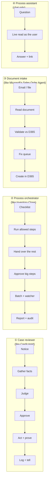

# 08 — What These Agents Make Possible: a Guide for Finding New Use Cases

The two sample agents aren't only "a credit hold agent" and "an inventory close agent". Each one is a set of **capabilities** that can be put together in new ways. This guide pulls those capabilities apart, shows the four kinds of agent you can build from them, and gives you a list of ideas and a quick test, so you can research new use cases with customers.

> **In one sentence:** if a person today **notices** something in D365, **looks up** facts on several screens, **judges** them against a written rule, **asks** someone to approve, **acts** in D365 and **tells** others, an agent can do most of that work. The person keeps the decision.

---

## 1. The building blocks

Think of each capability as a Lego brick. Each row says what the brick does in plain words, where it has already been shown working, and what else it could do.

| # | Capability | What it does, in plain words | Already shown in | What else it makes possible |
| --- | --- | --- | --- | --- |
| 1 | **Notice** | Spots new work without anyone asking: a scheduled check, a D365 business event, a change to a Dataverse row, an email arriving, or a chat message | Credit Hold (scheduled check finds new holds); Inventory Close (a task's status changes); Microsoft's Sales Order Agent (email with a PDF) | React to anything with a date, a status or an event: an invoice blocked for a price mismatch, a late delivery, a case near its SLA |
| 2 | **Gather facts** | Collects the facts a person would look up on several screens, from D365 and Dataverse, reading only the fields needed | Credit Hold (credit limit, balance, overdue days, last payment, open opportunities, dispute cases) | Combine ERP data (orders, invoices, stock) with CRM data (relationship, complaints) and documents (policies, contracts) |
| 3 | **Judge against a written rule** | Applies a policy and returns a recommendation with reasons that cite the numbers | Credit Hold (Release / Keep / Review, 2–4 reasons, confidence) | Any rule a business writes down: approval limits, tolerances, discount rules, quality criteria. The business can edit the rule without a developer |
| 4 | **Know when to ask a person** | Fixed rules, not the AI, decide when a person must decide: amount above a limit, missing data, low confidence | Credit Hold (orders over the limit always go to a person); both (the autonomy level is set per action) | Start every new agent at "recommend only", then let it act alone on small, clear cases once it has proved itself |
| 5 | **One-click approval** | Sends the case to the right person in Teams or Outlook and records their decision and comment | Credit Hold (release card); Inventory Close (approval before the close) | Any decision a manager makes today by opening D365: discounts, write-offs, releases, journal postings, period changes |
| 6 | **Act in D365 and prove it** | Makes the change, then reads D365 again to confirm it really happened; never reports success it didn't see | Both (status written only by flows and confirmed by a fresh read) | Release, update, create a draft document, start a batch job, open or hold a period |
| 7 | **Run a checklist** | Works through a list of steps in order, respecting who owns each step, what it depends on, and which steps it is allowed to do | Inventory Close (8-task checklist, *Agent enabled* gate, `#autostart` chaining, stops at the first step a person owns) | Any recurring process with a checklist: month-end close per module, onboarding, year-end, audit preparation, cut-over |
| 8 | **Hand long jobs to D365** | Starts a long batch job, doesn't wait in the chat, and a watcher completes the step when the job has really finished | Inventory Close (inventory close as a batch job) | Recalculations, revaluations, depreciation proposals, MRP runs, settlement |
| 9 | **Tell the right people** | Sends handoffs, reminders, escalations and reports to the owner of the work only, with the wording a business owner controls | Inventory Close (handoff, review, reminder, escalation emails); Credit Hold (sales owner told of the decision) | Chase owners for overdue tasks, explain to sales why an order is held, send a daily status report |
| 10 | **Remember and audit** | Keeps one record per item and one audit row per decision, viewable in an app | Both (review app and compliance review app) | Evidence for auditors, a work queue for exceptions, measuring how often the agent was right |
| 11 | **Answer questions** | Answers "why", "what's open" and "who decided" in chat from live data, limited to what that person may see in D365 | Both (chat with the Dynamics 365 ERP and Dataverse MCP servers) | A self-service help desk for a process: "Why hasn't my order shipped?" "What's left in the close?" |
| 12 | **Read documents** | Extracts structured data from PDFs and emails | Microsoft's Sales Order Agent (customer PO to sales order) | Vendor invoices, delivery notes, certificates, contracts, remittance advice |
| 13 | **Be sold and switched off** | Business rules are served by your licensing service; they stop when the licence ends, and the customer's data never leaves their tenant | Both (licensed skills, offline fallback, settings in the customer's environment variables) | Sell any new agent as a monthly subscription without giving away the know-how |
| 14 | **Stay affordable** | Flows do the routine fetching, the AI only judges, and tools read only what they need | Both (lean design; about S$120–250 a month in Microsoft usage) | Run high-volume agents (hundreds of items a month) at a predictable cost |

Microsoft's other templates add a few more bricks you can borrow: creating users and roles (User Onboarding Agent), reading telemetry to diagnose batch jobs (Batch Framework Telemetry Agent), and matching payment files (Payment Recon Agent). See [04 — FastTrack anatomy](04-fasttrack-agents-anatomy.md#1-summary-matrix).

---

## 2. Four patterns you can build

Almost every idea fits one of four patterns. Pick the pattern first; it tells you which bricks you need and how much of the samples you can reuse.

| Pattern | Use it when… | One work item is… | Reuse from the samples (estimate) | Typical first build (estimate) |
| --- | --- | --- | --- | --- |
| **① Case reviewer** | Many similar exceptions, each needing a judgement | One exception (a hold, a blocked invoice, a late order) | Credit Hold: about 70% (tables, flows, card, licensing, evaluation) | 3–4 weeks |
| **② Process orchestrator** | A recurring checklist with owners, order and sign-offs | One task in the checklist | Inventory Close: about 60% (gates, claims, chaining, emails, audit) | 4–6 weeks |
| **③ Document intake** | Data arrives as PDFs or emails and is retyped into D365 | One document | Microsoft's Sales Order Agent | 3–5 weeks |
| **④ Process assistant** | People spend time looking things up or asking colleagues | One question | The chat half of either sample | 1–2 weeks |

A pattern ② agent often contains pattern ① inside it: each checklist step can be a small case review.

---

## 3. Use-case ideas to research

These are starting points for customer conversations, not tested designs. The value column says why a customer would care; check volumes and data access before promising anything.

### Finance

| Idea | Pattern | What the agent would do | Why it's valuable | Watch out for |
| --- | --- | --- | --- | --- |
| **Vendor invoice exceptions** | ① | Picks up invoices blocked by a price or quantity mismatch, gathers the PO, receipt and price history, recommends accept, ask the buyer, or reject | High volume; AP spends hours per exception | Needs clear tolerance rules; overlaps with Microsoft's own invoice capture features, so check those first |
| **Payment proposal review** | ① | Checks a payment proposal before release: new bank details, unusual amounts, duplicate invoices | Fraud and error prevention | Never let it change bank details; recommend only |
| **Customer collections** | ① | Ranks overdue customers, drafts the reminder in the right tone, asks the collector to approve | Faster cash; consistent follow-up | Customer emails are outward-facing: keep approval |
| **Period close for AP, AR, GL** | ② | The same checklist engine as Inventory Close for other modules | Days off the close; audit evidence | Microsoft's Period Close Agent covers parts of this: extend it, don't rebuild |
| **Intercompany reconciliation** | ② | Matches intercompany balances across legal entities, lists differences, hands them to owners | Painful, recurring, cross-entity | Needs consistent intercompany setup |
| **Budget overrun approvals** | ① | Reviews purchase requisitions that exceed budget with context, routes to the budget owner | Faster approvals with reasons | Budget control setup varies by customer |

### Supply chain

| Idea | Pattern | What the agent would do | Why it's valuable | Watch out for |
| --- | --- | --- | --- | --- |
| **Late inbound deliveries** | ① | Spots purchase lines past their confirmed date, checks which sales orders depend on them, drafts a chase to the vendor and a heads-up to sales | Fewer surprises for customers | Vendor emails are external: approval first |
| **Backorder allocation** | ① | When stock is short, proposes who gets it using customer priority and margin rules | Better service for key customers | Needs agreed allocation rules |
| **Quality order disposition** | ① | Gathers test results and history, recommends accept, rework or scrap | Faster release from quarantine | Regulated industries need strict audit (the audit brick helps) |
| **Cycle count variances** | ① | Reviews counting journals with large variances against recent movements; recommends post or recount | Fewer wrong adjustments | Posting stays with people |
| **Planned order review** | ① | Flags unusual planned orders after MRP (huge quantities, odd dates) before firming | Catches planning errors early | Planners must trust it: start read-only |
| **Warehouse exceptions** | ① / ④ | Explains failed waves or stuck work and suggests the fix; answers "why hasn't this shipped?" | Less firefighting in the warehouse | WMS events may need a custom business event |

### Business Central

| Idea | Pattern | What the agent would do | Why it's valuable | Watch out for |
| --- | --- | --- | --- | --- |
| **Blocked customer review** | ① | The Credit Hold pattern on Business Central data | Same value for smaller companies | BC has its own first-party agents: check overlap |
| **Month-end checklist** | ② | The Inventory Close pattern for a small finance team | Structure without a big close tool | Simpler gates; fewer approvals |

### Sales and service (Dataverse)

| Idea | Pattern | What the agent would do | Why it's valuable | Watch out for |
| --- | --- | --- | --- | --- |
| **Discount approval** | ① | Reviews quotes above a discount threshold with margin and customer history; routes to the sales manager | Faster quotes, consistent margins | Sales users need it in Teams, not another app |
| **Case escalation** | ① | Spots cases near their SLA, gathers order and delivery facts from ERP, recommends the next step | Fewer breached SLAs | Customer Service has first-party agents: extend them |
| **Order status assistant** | ④ | Lets sales and service ask "where is my order?" across CRM and ERP | Fewer internal calls and emails | Respect each user's D365 permissions (the MCP servers do) |

### Across the business

| Idea | Pattern | What the agent would do | Why it's valuable | Watch out for |
| --- | --- | --- | --- | --- |
| **Master data change requests** | ① | Checks a requested change to a vendor, customer or item against rules and duplicates; routes for approval | Cleaner data; fraud control | Bank detail changes need a strong human check |
| **New customer onboarding** | ② | Runs the steps: credit check, setup, first-order release | Faster first order | Many owners; good fit for the checklist engine |
| **Go-live / cut-over checklist** | ② | Tracks cut-over tasks, chases owners, reports readiness | A partner tool you can reuse on every project | One-off per project: price it as a service |

---

## 4. Test an idea in ten minutes

Score each question 0 (no), 1 (partly) or 2 (yes). **10 or more** is worth a workshop; **under 7** is probably not an agent yet.

| Question | Why it matters |
| --- | --- |
| Does it happen **often**: at least weekly, or dozens of items a month? | Value and payback come from volume |
| Does a person **look things up on several screens** today? | That's the time the agent saves |
| Is there a **written rule** (policy, tolerance, approval limit)? | The agent needs a rule to apply; no rule means inconsistent results |
| Is the data **reachable**: a data entity, an API page, or a Dataverse table? | No API, no agent (or a small custom entity first) |
| Can the result be **checked** in D365 afterwards? | "Act and prove" needs something to re-read |
| Is a wrong action **recoverable**, or can a person approve first? | Irreversible actions stay with people |
| Can you **measure** the win: hours, days, errors, cash? | You need it for the business case and the price |

**Not a good fit (use something else):**
- Moving data from A to B with no judgement: use an integration or a plain flow.
- Answers needed in under a second, or thousands of items an hour: use code or batch.
- Large-scale analysis and trends: use reporting (Power BI), maybe with a chat assistant on top.
- No written rule and no agreement on what "right" looks like: fix the process first.

---

## 5. What a new agent costs and takes

| | Rule of thumb |
| --- | --- |
| **Build** | 3–6 weeks for a first version, faster when it reuses a sample's pattern ([solution approach](02-solution-approach.md)) |
| **Microsoft usage** | About 50–250 Copilot credits per item with the lean design, roughly US$0.50–2.50; measure it before quoting ([validation kit](07-validating-copilot-consumption.md)) |
| **Your price** | Subscription per agent per month plus setup ([commercial model](06-commercial-model.md), [calculator](../tools/pricing-calculator/index.html)) |
| **Customer prerequisites** | D365 linked to a Power Platform environment, Copilot Studio credits, the MCP servers switched on, and a person who owns the rule |

---

## 6. What to keep in mind

- **Check Microsoft first.** Microsoft ships first-party agents in Finance, Supply Chain, Sales, Customer Service and Business Central, and adds more often. The best use cases extend them or fill gaps between them ([Phase 0 — Qualify](02-solution-approach.md#phase-0--qualify-build-extend-or-buy)).
- **Some parts are preview.** The Dynamics 365 ERP MCP server, the Agents connector used to start an agent from a flow, and the Copilot harness change often. Confirm on Microsoft Learn before you promise a date.
- **The AI judges; it doesn't decide alone at first.** Every pattern above starts at "recommend" and earns "act" through evaluation results ([autonomy ladder](02-solution-approach.md#22-decide-the-autonomy-level-per-action)).
- **Limits to design around:** agent flows must finish in about 100 seconds (long work goes to batch), each agent action costs credits (keep routine work in flows), and the agent sees only what its connections and the user's D365 role allow.

---

## 7. From idea to proposal

1. **Shortlist** three ideas with the customer using the ten-minute test.
2. **Workshop** the best one for two hours: watch someone do three real cases and fill in the [agent design canvas](../templates/agent-design-canvas.md).
3. **Pick the pattern** and the sample to copy ([`templates/new-agent-starter/`](../templates/new-agent-starter/README.md)).
4. **Price it** with the calculator: items per month, minutes saved, Lean design.
5. **Prove it** in a sandbox at "recommend only", measure accuracy and credits, then quote firmly.
