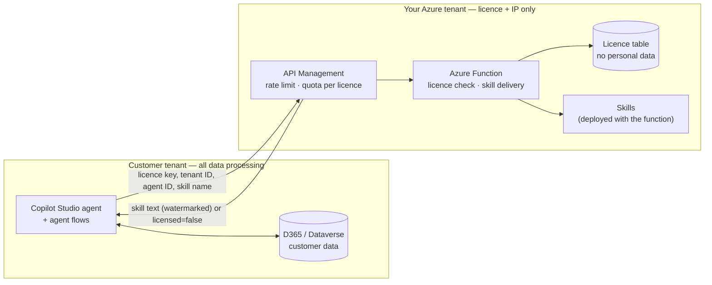

# Licensed Skills Service

A small Azure service that **hands out your agents' business skills only while a customer's licence is valid**. All processing of customer data stays in the customer's own Microsoft tenant. This service never receives business data or personal data, which keeps it outside the scope of PDPA (Singapore's personal data law) as far as the design can achieve. Confirm the legal position for your contracts.

It is the "Option C, minimal" design: the customer gets the agent's plumbing (flows, tables, apps, safety rules), and you keep the rulebook that makes the agent useful.

## 1. What crosses the boundary



| Sent to this service | Returned | Never sent |
| --- | --- | --- |
| Licence key (header), customer tenant ID (optional header), agent ID, skill name | Skill text with a watermark, licence state and notice, or `licensed: false` | Customer, vendor or employee names, account numbers, amounts, items, emails, user identities, D365 data, conversation text |

**What is stored:** licence ID, the customer's company name, tenant ID, licensed agents, tier, start and expiry dates, grace days, status and a SHA-256 hash of the key. No contact persons, no emails.

**What is logged:** one line per request with operation, licence ID, agent, skill and outcome. No headers, bodies, keys, tenant IDs or IP addresses ([`src/lib/log.js`](src/lib/log.js)). API Management strips `x-forwarded-for`; don't turn on body logging there.

## 2. Licence lifecycle

| State | When | Skills served? | What the agent does |
| --- | --- | --- | --- |
| `active` | More than 30 days before expiry | ✅ | Works normally |
| `expiring` | 30 days or less before expiry | ✅ + notice | Shows the renewal notice in reports |
| `grace` | Up to 7 days after expiry (per licence) | ✅ + daily warning | Works, warns every run |
| `expired` | After the grace period | ❌ | Starts no new tasks, records `LicenceExpired`, hands work to people |
| `suspended` | You set `status = suspended` (e.g. unpaid) | ❌ | Same as expired |
| `not-started` | Before the start date | ❌ | Same as expired |
| `tenant-mismatch`, `agent-not-licensed` | Key used in another tenant or for another agent | ❌ | Same as expired |

A task that already started is never interrupted: the samples only fetch skills when a **new** task starts, and work handed to batch or waiting for approval continues.

Invalid or missing keys get HTTP 401 with the same message in every case, so nobody can probe which licence IDs exist. All licence-state problems return HTTP 200 with `licensed: false` and a readable `notice`, so agents and flows can stop cleanly instead of failing on a connector error.

## 3. API

Base URL: `https://<apim-name>.azure-api.net/licensing`. Header `x-licence-key` is required; `x-tenant-id` is optional and checked when sent.

| Method | Path | Returns |
| --- | --- | --- |
| GET | `/v1/agents/{agentId}/licence` | `{ licensed, state, tier, expiresOn, daysLeft, notice }` |
| GET | `/v1/agents/{agentId}/skills` | `{ licensed, state, notice, skills: [{ name, version, description }] }`. Descriptions only, never the skill bodies |
| GET | `/v1/agents/{agentId}/skills/{skillName}` | `{ licensed, state, notice, skill, version, content }` |
| POST | `/mcp/{agentId}` | MCP server (Streamable HTTP, stateless) with tools `licence_status`, `list_skills`, `get_skill` |

The Power Platform custom connector definition is [`connector/apiDefinition.swagger.json`](connector/apiDefinition.swagger.json). It contains both the REST operations (for agent flows) and the MCP operation (`x-ms-agentic-protocol: mcp-streamable-1.0`, for the agent's Tools).

## 4. Folder contents

| Path | Contains |
| --- | --- |
| [`skills/`](skills/) | The licensed content: `manifest.json` plus one Markdown file per skill and agent. **This is your IP.** It is deployed with the function and never shipped to customers |
| [`src/lib/licence.js`](src/lib/licence.js) | Licence rules (states, warning, grace) |
| [`src/lib/service.js`](src/lib/service.js) | Authorization and the three operations, shared by REST and MCP |
| [`src/lib/mcp.js`](src/lib/mcp.js) | Minimal MCP JSON-RPC handler |
| [`src/lib/keys.js`](src/lib/keys.js) | Key format `lic-<id>.<secret>`, hashing, constant-time compare |
| [`src/lib/skills.js`](src/lib/skills.js) | Catalogue loading and watermarking |
| [`src/lib/store.js`](src/lib/store.js) | Licence storage: Azure Table (managed identity) or a local JSON file for development |
| [`src/functions/`](src/functions/) | Azure Functions HTTP triggers |
| [`tools/issue-licence.mjs`](tools/issue-licence.mjs) | Issues a licence and prints the key once |
| [`tools/validate-skills.mjs`](tools/validate-skills.mjs) | Checks the manifest before deployment |
| [`infra/deploy.sh`](infra/deploy.sh) · [`infra/apim-policy.xml`](infra/apim-policy.xml) | Azure CLI deployment (Southeast Asia) and the API Management policy |
| [`test/`](test/) | 25 unit tests (`npm test`) |

## 5. Run locally

```bash
cd licensing-service
npm install
npm test
```

```bash
cp local.settings.example.json local.settings.json
node tools/issue-licence.mjs --customer "Contoso Pte Ltd" --agents credit-hold-review-agent,inventory-close-agent --expires 2027-10-31 --local ./dev/licences.json
```

```bash
func start
```

```bash
curl -H "x-licence-key: <key printed above>" http://localhost:7071/api/v1/agents/credit-hold-review-agent/licence
```

## 6. Deploy to Azure

1. Review and run [`infra/deploy.sh`](infra/deploy.sh). It creates the storage, licence table, Function App on Flex Consumption with a managed identity (Table Data Reader only), and API Management (Consumption).
2. Apply [`infra/apim-policy.xml`](infra/apim-policy.xml) to the `licensing` API.
3. Issue a licence for each customer:

   ```bash
   LICENCE_TABLE_URL=https://<storage>.table.core.windows.net node tools/issue-licence.mjs --customer "Contoso Pte Ltd" --tenant <customer-entra-tenant-id> --agents inventory-close-agent --tier Standard --starts 2026-11-01 --expires 2027-10-31
   ```

4. Send the printed key to the customer's admin through a secure channel. They store it in the agent's **secret** environment variable (backed by Azure Key Vault).

Deployment hasn't been tested against a live Azure subscription from this repo; review each command first.

## 7. Connect an agent (customer side)

1. **Custom connector:** import [`connector/apiDefinition.swagger.json`](connector/apiDefinition.swagger.json) in Power Apps (set `host` to your API Management name), and add it to the agent's solution. Authentication: API key, header `x-licence-key`.
2. **Agent tool:** in Copilot Studio, **Tools → Add a tool → Model Context Protocol**, and pick the connector's MCP operation. Or use the MCP onboarding wizard with URL `https://<apim>.azure-api.net/licensing/mcp/<agentId>` and API-key header `x-licence-key`.
3. **Agent flows** call the REST operations (`GetLicenceStatus`, `GetSkill`) with the connector.
4. Add the **Licensed Skills** connector to the customer's data policy (DLP) in the same group as Dataverse.

The sample agents show exactly where: [Credit Hold Review Agent](../samples/credit-hold-review-agent/README.md#licensing) and [Inventory Close Agent](../samples/inventory-close-agent/README.md#licensing).

## 8. Operating it

| Task | How |
| --- | --- |
| Renew | Update `expiresAt` on the licence row. The key stays the same |
| Suspend (e.g. unpaid) | Set `status` to `suspended`; set it back to `active` to resume |
| Rotate a key | Issue a new licence, send the new key, then suspend the old one |
| Release a new skill version | Edit the Markdown, bump `version` in `manifest.json`, run `npm run validate-skills` and `npm test`, redeploy. Every customer gets it on the next task |
| Trace a leaked copy | Search for the watermark line `licensed-content licence=lic-…` |
| Usage per customer | API Management analytics by licence ID (calls per month) for tier limits and overage |

## 9. Limits

- **Transcripts:** skill text appears in conversation transcripts while the agent runs, so an admin could collect it. Watermarks, frequent versions and your contract cover that. No technical design fully prevents it.
- **Availability:** if the service is unreachable, agents fail closed and stop new tasks. Run it in a region close to your customers and monitor it. Your SLA to customers depends on it.
- **Cost:** each fetched skill is one extra agent tool call in the customer's Copilot credits.
- **Not legal advice:** confirm with counsel that the data boundary meets your PDPA and contract obligations.
