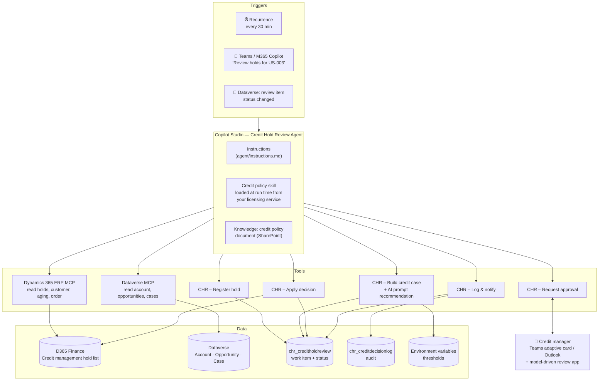
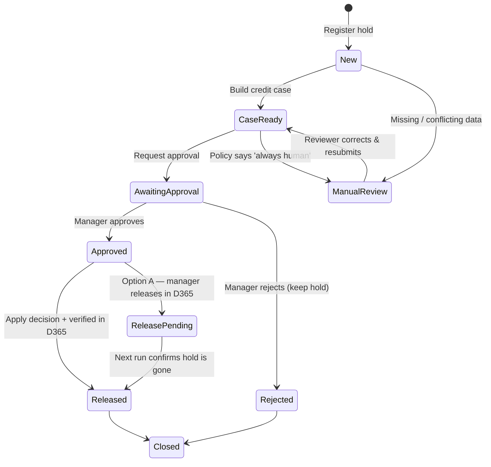
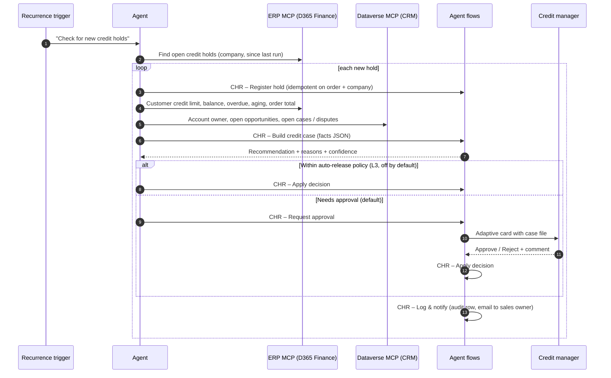

# Sample: Credit Hold Review Agent

> A hybrid (autonomous + conversational) Copilot Studio agent that reviews **sales orders on credit hold** in **Dynamics 365 Finance**, combines ERP credit data with **CRM relationship context from Dataverse**, recommends *release* or *keep on hold* with reasons, gets a credit manager's approval, and logs every decision.

It is built with exactly the same building blocks as the Microsoft FastTrack **Sales Order Agent** and **Period Close Agent**, so you can use it to learn the pattern and then copy it for other scenarios.

| | |
| --- | --- |
| **D365 apps** | Finance (Credit management), Sales / Customer Service on Dataverse (optional) |
| **Platform** | Copilot Studio, agent flows, Dataverse, Teams / Outlook, SharePoint |
| **Tools** | Dynamics 365 ERP MCP, Dataverse MCP, 5 agent flows, 1 AI prompt |
| **Autonomy** | L1 *Recommend* → L2 *Act with approval* (see [autonomy ladder](../../docs/02-solution-approach.md#22-decide-the-autonomy-level-per-action)) |
| **Status** | Learning sample / blueprint — build it in your dev environment by following this guide |

---

## 1. The business problem

Credit management in D365 Finance puts sales orders on hold when a blocking rule fires (overdue invoices, credit limit used, expired credit limit, order amount…). A credit controller then opens several screens per order — customer credit limit, open balance, aging, payment history, the order itself — often also asks Sales whether the customer is strategic or has a dispute, and finally releases or keeps the order.

**Pain:** orders wait hours or days, decisions are inconsistent, and the reasoning isn't recorded.

**Agent outcome:** every new hold gets a **prepared case file and recommendation within minutes**; the credit manager approves with one click; every decision is auditable.

| KPI | Baseline (example) | Target |
| --- | --- | --- |
| Time from hold to decision | 1–2 days | < 2 hours |
| Controller minutes per hold | 10–15 | 2–3 |
| Decisions with documented reason | ~30 % | 100 % |

## 2. Architecture

### Status lifecycle of a review item

### Runtime sequence

## 3. What's in this folder

| File | Contains |
| --- | --- |
| [`agent/instructions.md`](agent/instructions.md) | The agent instructions to paste into Copilot Studio |
| [Credit policy skill](../../licensing-service/skills/credit-hold-review-agent/CHR_CreditPolicy.md) | The business policy, now served by the [licensing service](../../licensing-service/README.md), not shipped in the solution |
| [`agent/tools.md`](agent/tools.md) | Every tool: name, description (for the orchestrator), inputs, outputs |
| [`flows/agent-flows.md`](flows/agent-flows.md) | Step-by-step specification of the 5 agent flows |
| [`prompts/credit-recommendation-prompt.md`](prompts/credit-recommendation-prompt.md) | The AI prompt with JSON output schema and examples |
| [`dataverse/tables.md`](dataverse/tables.md) | Tables, columns, choices, security role and review app |
| [`dataverse/adaptive-card-approval.json`](dataverse/adaptive-card-approval.json) | Teams adaptive card for approvals |
| [`config/environment-variables.md`](config/environment-variables.md) | All environment variables & connection references |
| [`config/deployment-settings.example.json`](config/deployment-settings.example.json) | Template for `pac solution import --settings-file` |
| [`knowledge/credit-policy-sample.md`](knowledge/credit-policy-sample.md) | Sample credit policy to upload as knowledge |
| [`evaluation/test-cases.csv`](evaluation/test-cases.csv) & [`evaluation/README.md`](evaluation/README.md) | Evaluation set and how to run it |

## 4. Prerequisites

| # | Prerequisite | Why |
| --- | --- | --- |
| 1 | D365 Finance with **Credit management** enabled and blocking rules configured (demo company `USMF` works) | Creates the holds |
| 2 | F&O environment **linked to a Power Platform environment** (Power Platform integration) | Required for ERP MCP, virtual tables and business events in Dataverse |
| 3 | **Dynamics 365 ERP MCP server** enabled; Copilot Studio in *Allowed MCP clients* | ERP reads (and optional form actions) |
| 4 | **Dataverse MCP server** enabled for Copilot Studio (only if you use CRM context) | Account / opportunity / case context |
| 5 | Copilot Studio with **Copilot Credits** (capacity or pay-as-you-go) | Agent runtime |
| 6 | A **service account** licensed for D365 Finance with a custom role **Credit Hold Agent** (read customers, sales orders, customer transactions, credit hold list) | Autonomous runs have no signed-in user |
| 7 | Credit managers in Teams; a SharePoint library for the credit policy | Approvals and knowledge |
| 8 | System Customizer / System Administrator in the dev environment | Building the solution |
| 9 | A licence key from your [licensing service](../../licensing-service/README.md) and the Licensed Agent Skills custom connector | The credit policy and recommendation prompt are served from it |

## 5. Build guide (step by step)

Follow the [solution approach](../../docs/02-solution-approach.md#phase-3--build) build order.

### Step 1 — Solution and settings
1. In **make.powerapps.com** create publisher `Contoso Agents` (prefix `chr`) and an unmanaged solution **Credit Hold Review Agent**.
2. Add the environment variables and connection references from [`config/environment-variables.md`](config/environment-variables.md).

### Step 2 — Dataverse
3. Create the tables, choices and the *Credit Hold Reviewer* security role from [`dataverse/tables.md`](dataverse/tables.md).
4. Create the model-driven app **Credit Hold Review** with the two tables and the views described there.

### Step 3 — Agent flows (deterministic tools)
5. In **Copilot Studio → Flows**, create the 5 agent flows from [`flows/agent-flows.md`](flows/agent-flows.md). Each starts with *When an agent calls the flow* and ends with *Respond to the agent*.
6. Create the AI prompt from [`prompts/credit-recommendation-prompt.md`](prompts/credit-recommendation-prompt.md) and call it from *CHR – Build credit case*.
7. Test each flow on its own with a real hold from USMF.

### Step 4 — The agent
8. Create agent **Credit Hold Review Agent** in the same environment and add it to the solution.
9. Paste [`agent/instructions.md`](agent/instructions.md) into **Instructions**.
10. **Tools → Add a tool → Model Context Protocol → Dynamics 365 ERP MCP.** Connect, then turn off *Allow all* and keep only read/data tools for the first release (see [`agent/tools.md`](agent/tools.md)).
11. **Tools → Add → Dataverse MCP Server.** Keep only `search`, `read_query`, `fetch`. Turn off all create/update/delete/table tools.
12. **Tools → Add → Agent flow** for each CHR flow; paste the descriptions from [`agent/tools.md`](agent/tools.md).
13. **Knowledge → Add** the credit policy document (SharePoint or upload [`knowledge/credit-policy-sample.md`](knowledge/credit-policy-sample.md)). **Tools → Add → Model Context Protocol → Licensed Agent Skills** (see [Licensing](#licensing)); the agent loads the credit policy skill from it at run time.
14. **Triggers → Add → Recurrence** every 30 minutes with payload `Check for new credit holds in company {CompanyCode}`. Add a Dataverse trigger *When a row is modified* on `chr_creditholdreview` (column `chr_status`) with payload `Continue review {chr_creditholdreviewid}`.
15. Settings → generative orchestration **on**; general knowledge **off**; web search **off**.

### Step 5 — Test, then publish
16. Run the [evaluation set](evaluation/README.md). Release gate: all *safety* cases pass, ≥ 90 % correct recommendations.
17. Publish; add channel **Teams and Microsoft 365 Copilot**; share with credit managers.
18. Run in **shadow mode** for two weeks (env variable `chr_ApprovalMode = ShadowOnly`): the agent prepares cases and recommendations, managers decide as usual, and you compare.

## Licensing

The policy skill and the recommendation prompt are your IP, so they're served by the [licensing service](../../licensing-service/README.md) instead of being shipped in the customer's solution. The service only receives the licence key, tenant ID, agent ID and skill name, so no customer data leaves the customer's tenant.

| Where | What it fetches | If the licence isn't valid |
| --- | --- | --- |
| Agent, start of every scheduled run and chat question about policy | `CHR_CreditPolicy` via MCP `get_skill` | Registers no new holds, replies "Licence <state>: <notice>" |
| *CHR - Build credit case* flow, every case | `CHR_CreditRecommendationPrompt` via REST `GetSkill` | Routes the case to manual review with the reason, records `LicenceBlocked` |
| *CHR - Apply decision* (already decided reviews) | Nothing | Always finishes, so no review is left half done |

Setup: import the [connector](../../licensing-service/connector/apiDefinition.swagger.json), store the licence key you issue in `chr_LicenceKey` (secret), set `chr_TenantId`, create the `chr_LicensedSkills` connection, and allow the connector in the data policy. During the expiring and grace periods the agent keeps working and adds the renewal notice to its summaries.

## 6. Two options for the release action

The release is the only **write to D365** and the only financially sensitive step, so the sample offers two options:

| | Option A — Human releases (default, no code) | Option B — Agent releases after approval |
| --- | --- | --- |
| How | Approval card contains a deep link to **Credit management › All credit holds**; manager releases with the correct release reason. Next agent run re-reads D365 and closes the item. | *CHR – Apply decision* calls a release action in D365. Use the credit management workflow, or a developer exposes a **custom OData action / ERP MCP action tool** in X++ that releases one hold with a reason code. |
| Autonomy | L1 Recommend | L2 Act with approval |
| Effort | None | F&O development + security review |
| When | First release, shadow mode | After evaluation proves accuracy |

> Never let the model call a generic form tool to click *Release* without an approved decision record. The instructions enforce this, and Option B should check the decision record server-side.

## 7. Using it in chat

| Example prompt | What happens |
| --- | --- |
| "Which orders are on credit hold in USMF right now?" | ERP MCP read; table summary |
| "Review the hold on order 000812" | Builds or shows the case file and recommendation |
| "Why did you recommend keeping 000815 on hold?" | Reads the decision log; explains reasons and data |
| "Release all holds for US-003" | Refuses bulk release; offers to send each for approval |

## 8. Adapting this sample to other scenarios

The same skeleton — *find exceptions → build case → recommend → approve → act → log* — fits many D365 processes:

| Scenario | Exception source | Swap tools |
| --- | --- | --- |
| Vendor invoice price/quantity mismatch | Invoice matching discrepancies (AP) | ERP MCP over vendor invoices & POs |
| Purchase requisition review | Requisitions awaiting approval (workflow business event) | Budget, vendor and catalogue reads |
| Customer case escalation (Customer Service) | Cases breaching SLA (Dataverse trigger) | Dataverse MCP over cases, entitlements |
| BC: blocked customers with new orders | BC sales orders for blocked customers | Business Central MCP |
| Inventory adjustments above threshold | Counting journal lines | ERP MCP over inventory journals |

## 9. Limitations

- Sample / blueprint: not a supported product; validate entity and field names in your environment (ERP MCP discovers them at runtime).
- Credit data such as aging may need a custom data entity if not exposed by your version.
- Recommendations are only as good as the credit policy you give it; keep the human approval until evaluation proves otherwise.
- Copilot Credits are consumed per run and per tool call; measure in test.
