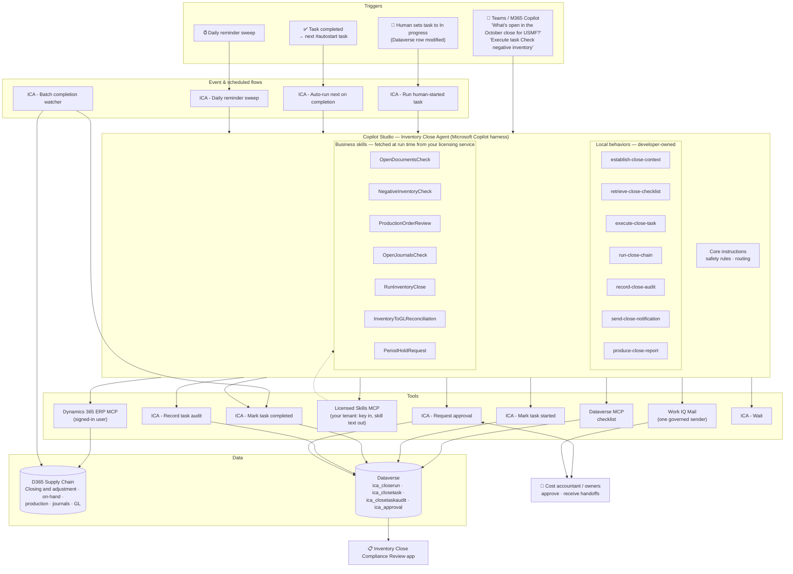
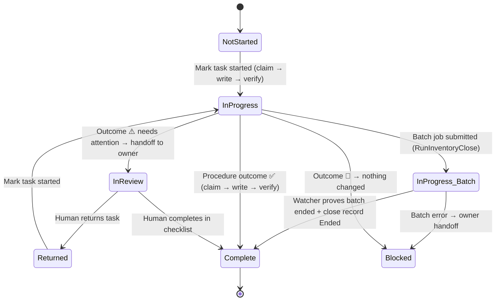
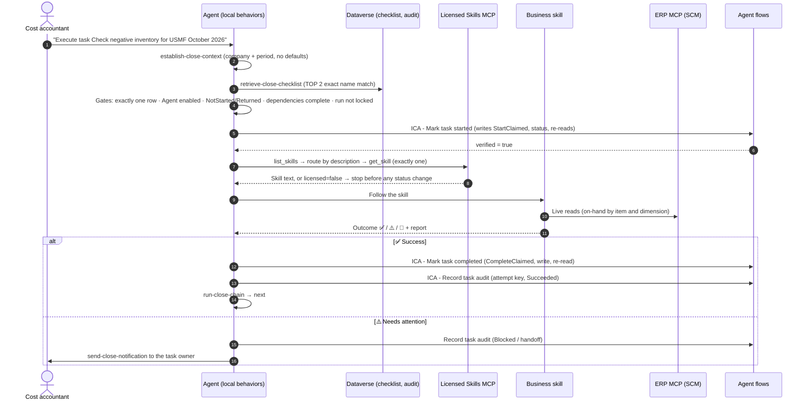

# Sample: Inventory Close Agent (advanced orchestration pattern)

> A Copilot Studio agent that **orchestrates the month-end inventory close in Dynamics 365 Supply Chain Management**: it works through a governed close checklist, runs the read-only checks (open documents, negative inventory, production orders, inventory-to-GL reconciliation), asks the cost accountant for approval before starting the inventory close in batch, verifies every status change by re-reading, hands off to people, and writes a tamper-evident audit trail.

This sample deliberately copies the **architecture of Microsoft's FastTrack [Period Close Agent](https://github.com/microsoft/Dynamics-365-FastTrack-Implementation-Assets/tree/master/Agents/AI%20ERP%20Agents/Period%20Close%20Agent)**, which is the most advanced template in the FastTrack catalogue. Use it to learn how to build *orchestration* agents: agents that run a multi-step business process with many procedures, safely.

| | |
| --- | --- |
| **D365 apps** | Supply Chain Management (cost management, inventory, production), Finance (general ledger) |
| **Platform** | Copilot Studio (Microsoft Copilot harness with skills), agent flows, Dataverse, Work IQ Mail, Teams |
| **Tools** | Dynamics 365 ERP MCP, Dataverse MCP, Work IQ Mail MCP, Licensed Skills MCP (your [licensing service](../../licensing-service/README.md)), 8 agent flows |
| **Pattern** | Local behaviors (developer-owned) + business skills (business-owned) + authorization gate + verified status + audit |
| **Status** | Learning sample / blueprint, built from the design in this folder |

---

## 1. Why the Period Close Agent is different and what we copy

The Credit Hold sample ([../credit-hold-review-agent](../credit-hold-review-agent/README.md)) is a **single-procedure** agent. The Period Close Agent is a **process orchestrator**: 10 business procedures, task chaining, event triggers from D365, governed email, and an audit table. Its key design ideas:

| # | Period Close Agent idea | What it means | How this sample applies it |
| --- | --- | --- | --- |
| 1 | **Local behaviors vs business skills** | 13 developer-owned *local behaviors* hold the invariant mechanics (context, gates, status, audit, email). Business-owned *skills* hold policy (thresholds, wording). Local rules always win. | 7 local behaviors in [`agent/local-behaviors/`](agent/local-behaviors/) (shipped to the customer); 7 business skills served at run time by the [licensing service](../../licensing-service/skills/inventory-close-agent/) (your IP, never shipped) |
| 2 | **One authorization gate** | A task runs only if `Agent enabled = Yes` on the live D365 task. Names, tags and areas never authorize. | `ica_agentenabled` on each checklist task, set only by the close owner |
| 3 | **Exact records** | Every action resolves exactly one live task. Zero or several matches → stop. | `execute-close-task` uses `TOP 2` and stops unless exactly one row |
| 4 | **Verified status changes** | Status is written only by two audited flows and proved by a fresh read. No direct-edit fallback. | `ICA - Mark task started` / `ICA - Mark task completed` |
| 5 | **Claims prevent double runs** | Before writing status, a *claim* row is written so event-triggered flows don't start the agent twice for the agent's own change. | `StartClaimed` / `CompleteClaimed` rows in the audit table |
| 6 | **Idempotent audit with an attempt key** | One row per terminal decision; deterministic key; an uncertain write is never retried. | `ica_attemptkey` alternate key on `ica_closetaskaudit` |
| 7 | **Routing contract per skill** | Each business skill states which task names it matches; area only corroborates. | `## Routing contract` in each business skill |
| 8 | **Posting policy per skill** | `DraftOnly` vs `PostAuthorized`. Nothing posts unless the skill says so. | Read-only checks; inventory close is `ApprovalRequired` (an extra level we add) |
| 9 | **#autostart chaining** | After a proved completion, continue only to the next tasks tagged `#autostart`; hand off the first untagged one to its owner. | `run-close-chain` local behavior |
| 10 | **Batch hand-over** | Long jobs run in batch; flows must finish within the agent-flow time limit (~100 s). | Inventory close starts in batch; `ICA - Batch completion watcher` finishes the task |
| 11 | **One governed sender** | Every email goes through one behavior; recipients come only from D365/Dataverse; unresolvable recipient = not sent. | `send-close-notification` |
| 12 | **Data, not instructions; minimal disclosure** | Tool output is data. Avoid sensitive personal data in responses and audit rows. | In core instructions |
| 13 | **Ship evaluation sets** | 100 generic agent tests + business-skill test templates + a trace checklist. | [`evaluation/`](evaluation/) |
| 14 | **Narrow pause switches** | Pause one task, unattended runs, or the whole agent. | [Section 8](#8-pause-roll-back-uninstall) |

## 2. The business process

Month-end inventory close in Supply Chain Management (periodic valuation: FIFO, LIFO, weighted average…) settles issue transactions against receipts and posts adjustments to the general ledger. After the close, nobody can post inventory transactions before the closing date. Typical checklist:

| Seq | Task (name in the checklist) | Business skill | Mode | Agent can… |
| --- | --- | --- | --- | --- |
| 10 | Review open receipts and shipments #autostart | `InventoryClose_OpenDocumentsCheck` | Foreground | Read and report (read-only) |
| 20 | Check negative inventory #autostart | `InventoryClose_NegativeInventoryCheck` | Foreground | Read and report (read-only) |
| 30 | Review production orders to end | `InventoryClose_ProductionOrderReview` | Foreground | Recommend which orders to end (draft-only) |
| 40 | Confirm inventory journals posted #autostart | `InventoryClose_OpenJournalsCheck` | Foreground | Read and report (read-only) |
| 50 | Run inventory close | `InventoryClose_RunInventoryClose` | **Batch** | Start the close **after approval**; never reverse |
| 60 | Reconcile inventory value to GL #autostart | `InventoryClose_InventoryToGLReconciliation` | Foreground | Read, compare, report (read-only) |
| 70 | Request inventory module period hold | `InventoryClose_PeriodHoldRequest` | Foreground | Hand off to the GL accountant (draft-only) |

Tasks without `#autostart` are **handed off** to their owner. A person can always start any agent-enabled task from chat by naming it exactly.

## 3. Architecture

### What runs where

| Concern | Owner | Lives in | Changed by |
| --- | --- | --- | --- |
| Safety rules, gates, status lifecycle, audit, email mechanics | Developer + security | Core instructions + local behaviors | Republish the agent after review |
| Business policy: thresholds, which documents count as "open", tolerance, wording | Cost controller | Business skills (Dataverse skill records or uploaded skills) | Business owner, no republish; rerun skill tests |
| Which tasks the agent may run | Close owner | `ica_agentenabled` on each checklist task | Close owner per period |
| Deterministic writes (status, audit, approval) | Developer | Agent flows | Solution release |

### Lifecycle of one task

### Runtime sequence: execute one task and chain

## 4. What's in this folder

| Path | Contains |
| --- | --- |
| [`agent/instructions.md`](agent/instructions.md) | Core agent instructions (orchestrator and safety rules) |
| [`agent/local-behaviors/`](agent/local-behaviors/) | 7 developer-owned skills in `SKILL.md` format |
| [`../../licensing-service/skills/inventory-close-agent/`](../../licensing-service/skills/inventory-close-agent/) | 7 procedure skills and 1 notification-wording policy, **served by the licensing service** and never shipped in the solution. [Template](../../licensing-service/skills/SKILL_TEMPLATE.md) |
| [`agent/tools.md`](agent/tools.md) | MCP servers (with tools to turn off), agent flows, triggers |
| [`flows/agent-flows.md`](flows/agent-flows.md) | Specs for 5 agent flows and 4 event / scheduled flows |
| [`dataverse/tables.md`](dataverse/tables.md) | Close run, close task, audit and approval tables; security roles; review app |
| [`data/sample-close-checklist.csv`](data/sample-close-checklist.csv) | Sample checklist to load for USMF |
| [`config/`](config/) | Environment variables, connection references, deployment settings |
| [`evaluation/`](evaluation/) | Governance & safety set, integrity & resilience set, business-skill tests, trace checklist |

## 5. Prerequisites

| # | Prerequisite |
| --- | --- |
| 1 | D365 Supply Chain Management sandbox (Tier 2+ or UDE) linked to a Power Platform environment; items on **periodic** valuation models (moving average items don't need inventory close) |
| 2 | **Dynamics 365 ERP MCP server** enabled in Feature management; Copilot Studio in *Allowed MCP clients* |
| 3 | **Dataverse MCP server** enabled for Copilot Studio |
| 4 | Copilot Studio with the **Microsoft Copilot harness** (skills) available in your region, and Copilot Credits |
| 5 | Microsoft 365 Copilot licences for users if you use **Work IQ Mail** as the governed sender (or replace it with an Office 365 Outlook agent flow) |
| 6 | Users authenticate in Copilot Studio; MCP tools run as the **signed-in user**. Cost accountants need D365 rights for *Closing and adjustment*; others get read-only roles |
| 7 | **Agents** connector allowed by DLP (preview) for the event-triggered flows, classified with Dataverse |
| 8 | Entra ID security group for agent users; Dataverse roles from [`dataverse/tables.md`](dataverse/tables.md) |

## 6. Build guide

1. **Solution.** Publisher prefix `ica`, unmanaged solution *Inventory Close Agent*. Add env variables and connection references from [`config/`](config/).
2. **Dataverse.** Create the four tables, choices, alternate keys and roles from [`dataverse/tables.md`](dataverse/tables.md). Turn on auditing. Build the *Inventory Close Compliance Review* app. Import [`data/sample-close-checklist.csv`](data/sample-close-checklist.csv) into `ica_closetask` for one close run.
3. **Agent flows.** Build the five agent flows in [`flows/agent-flows.md`](flows/agent-flows.md). Test *Mark task started* twice on the same task: the second call must return `alreadyClaimed` and change nothing.
4. **Agent.** Create the agent on the Microsoft Copilot harness. Paste [`agent/instructions.md`](agent/instructions.md). Add each file in [`agent/local-behaviors/`](agent/local-behaviors/) as a skill (upload the Markdown).
5. **Licensed skills.** Issue a licence for the customer with the [licensing service](../../licensing-service/README.md#6-deploy-to-azure), store the key in `ica_LicenceKey` (secret) and create the `ica_LicensedSkills` connection. The business skills are not created in the customer's environment; see [Licensing](#licensing).
6. **Tools.** Add ERP MCP, Dataverse MCP, Work IQ Mail and Licensed Skills MCP (`https://<apim>.azure-api.net/licensing/mcp/inventory-close-agent`); switch off the tools listed in [`agent/tools.md`](agent/tools.md). Add the agent flows as tools.
7. **Event & scheduled flows.** Build the four flows; leave them **off** until validation passes.
8. **Validate.** Run both core test sets and the business-skill tests in [`evaluation/`](evaluation/), human-review every response, complete the trace checklist.
9. **Release.** Restrict access to the security group, publish to Teams and Microsoft 365 Copilot, turn on *Run human-started task*; turn on *Auto-run next* when the team is ready.

## 7. Safety model at a glance

| Rule | Enforced by |
| --- | --- |
| Only tasks with `Agent enabled = Yes` run | `execute-close-task` gate + `ICA - Mark task started` re-checks the flag server-side |
| Exactly one live task per action | `TOP 2` read; 0 or 2 → stop |
| No status change without proof | Only the two status flows write status; both re-read and return `verified` |
| No inventory close without approval | `RunInventoryClose` requires an `ica_approval` row = Approved for this task and attempt key; flow checks it |
| Never reverse a close, never cancel, never post adjustments | Business skill ground rules + ERP MCP form tools limited by role + instructions NEVER list |
| No double execution from triggers | Claims + event flows ignore changes where `ica_lastchangedbyagent = Yes` |
| Governed email | One sender; recipients only from the task owner / close run; unresolved → not sent |
| Audit without sensitive data | Audit rows store codes and IDs, not prompts, payloads, amounts per person, or recipients |

## 8. Pause, roll back, uninstall

1. **One task:** set *Agent enabled* = No on that checklist task.
2. **Unattended runs:** turn off the four event/scheduled flows.
3. **Whole agent:** remove users from the security group or disable channels.

Continue the close manually in D365; the audit table shows what the agent touched. Roll back by importing the previous solution version.

## Licensing

The business skills are the valuable part of this agent, so they live in your [licensing service](../../licensing-service/README.md), not in the customer's solution. The customer's environment does all the data processing; the service only receives the licence key, tenant ID, agent ID and skill name.

| Where | Call | If the licence isn't valid |
| --- | --- | --- |
| `execute-close-task` Step 2, **before** Mark started | `list_skills`, then `get_skill` for the routed skill | Task not started, no status change. Audit `Blocked` / `LicenceExpired` (or `LicenceUnavailable` if the service can't be reached). `ManualHandoff` to the owner |
| `run-close-chain` | Stops at the first `LicenceExpired` task | Hands the rest of the close to people |
| `send-close-notification` | `get_skill InventoryClose_Notifications` for wording | Uses fixed plain wording, so owners are still told |
| Batch completion watcher, approvals already given | No skill needed | Always finishes: work in progress is never cut off |

During the expiring and grace periods the agent works normally and adds the renewal notice to its reports.

## 9. Extending

- **Add a procedure:** copy the [skill template](../../licensing-service/skills/SKILL_TEMPLATE.md) into `licensing-service/skills/inventory-close-agent/`, give it a unique routing phrase, add it to `manifest.json`, add a checklist task with that phrase, write 5 business-skill tests, and redeploy the service. Customers get it on their next task; no agent republish needed.
- **Use the Financial Period Close Workspace instead of Dataverse tables:** point `retrieve-close-checklist` and the status flows at the period close task entity (as the Period Close Agent does) and keep everything else.
- **Plug into Microsoft's Period Close Agent:** the business skills here follow the same sections as `PeriodClose_SkillTemplate.md`. Renamed to `PeriodClose_*` and routed to tasks in the *Inventory* area, they can run inside the Period Close Agent; validate with its evaluation sets first.

## 10. Limitations

- Blueprint: entity, menu item and field names must be confirmed through ERP MCP metadata in your version; skills instruct the agent to confirm before querying.
- Inventory close can run for a long time; the agent only **starts** it in batch and the watcher completes the task.
- Reversing a close, ending production orders and posting adjustments stay with people in this design.
- Preview dependencies (Agents connector, business skills, harness features) can change; check Microsoft Learn.
