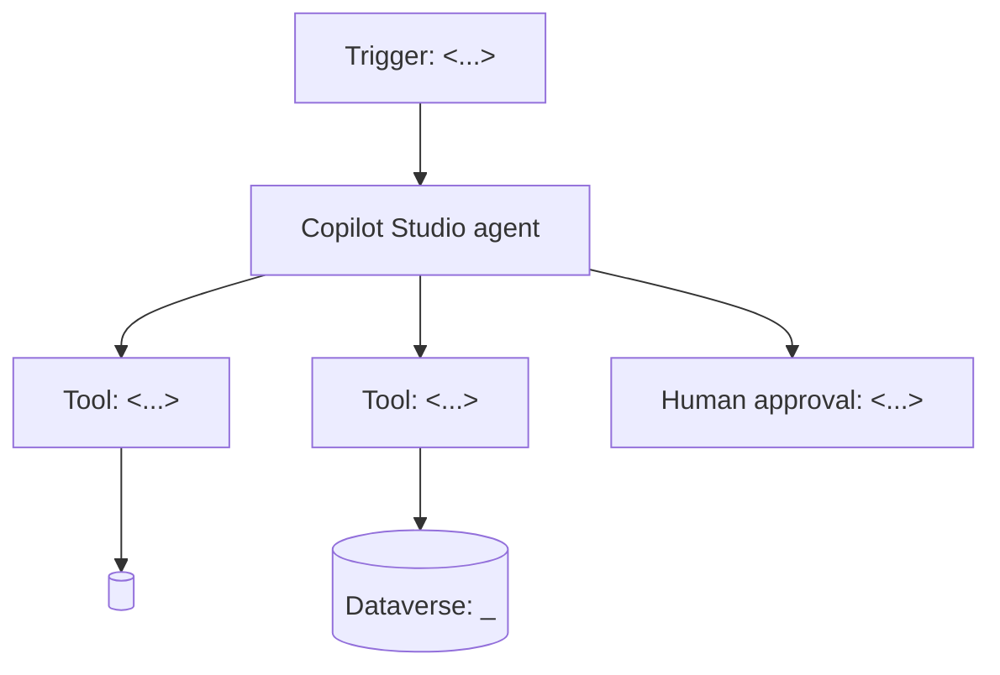
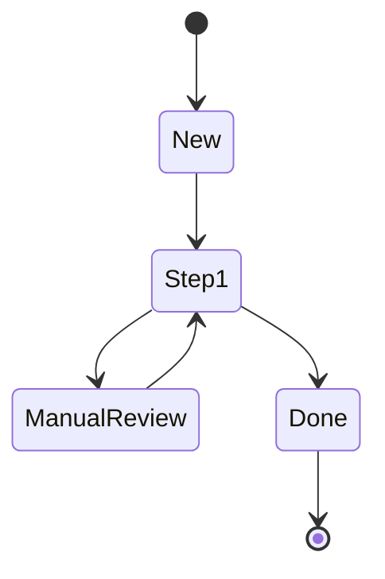

# <Agent name>

> Copy this folder to `samples/<agent-name>/` (or your own repo), replace every `<…>` placeholder, and delete what you don't need. The structure mirrors the [Credit Hold Review Agent](../../samples/credit-hold-review-agent/README.md) so every agent is documented the same way.

| | |
| --- | --- |
| **D365 apps** | <Finance / Supply Chain / Business Central / Sales / Customer Service / Field Service / Dataverse> |
| **Platform** | Copilot Studio, agent flows, Dataverse, <Teams / Outlook / SharePoint> |
| **Tools** | <MCP servers, agent flows, connectors, prompts> |
| **Autonomy** | <L0–L4 per action> |
| **Owner** | <business owner> / <technical owner> |

## 1. Business problem
<From design canvas boxes 1–2. Include KPIs: baseline → target.>

## 2. Architecture

### Status lifecycle

## 3. Folder contents
| File | Contains |
| --- | --- |
| `agent/instructions.md` | Agent instructions |
| `agent/tools.md` | Tool names, descriptions, inputs, outputs |
| `flows/agent-flows.md` | Agent flow specifications |
| `prompts/*.md` | AI prompts with JSON schemas and examples |
| `dataverse/tables.md` | Tables, choices, security roles, app |
| `config/environment-variables.md` | Environment variables & connection references |
| `knowledge/` | Policies / SOPs used as knowledge |
| `evaluation/test-cases.csv` | Evaluation set |

## 4. Prerequisites
## 5. Build guide
## 6. Using it
## 7. Limitations
